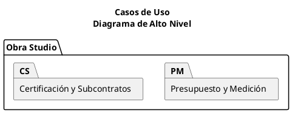
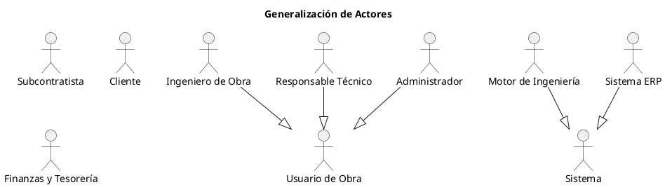

# Guía para completar TPF 04 — Modelo de Análisis (Obra Studio)

Archivo de trabajo para acelerar el llenado de la plantilla «Manual de Análisis» (Cátedra de Ingeniería del Software 2). Reúne, ya ordenado según las secciones de la plantilla, los datos de actores, casos de uso y matriz. Los textos completos de los requerimientos están en `requerimientos-consolidados.md`; aquí solo figuran identificador y título corto.

**Estado de los datos.** Actores, catálogo de 16 casos de uso y relaciones salen del TPF y del `modelo-de-analisis.md` del equipo. La matriz RF → CU sale del catálogo. La matriz de RNF y PR es una **propuesta** que hay que contrastar con la del TPF (ver Pendientes).

## 1. Orden de la plantilla y qué completar

| Sección de la plantilla | Qué va | Dónde está aquí |
|---|---|---|
| Portada | Grupo Nº, alumnos (Apellido, Nombre) | Completar a mano |
| Nombre del Proyecto | Nombre del proyecto | §2 |
| Objetivo del Proyecto | Objetivo general | §2 (borrador) |
| Modelo de Requerimientos | Enlace al documento | §2 |
| Actores | Tabla Actor / Descripción | §3 |
| Lista de Requerimientos | Tabla Id / Requerimiento con cambios en colores | §4 |
| Diagrama de Casos de Uso (Alto Nivel) | Por procesos o por actores | §6.1 |
| Diagrama de Generalización de Actores | Jerarquía de actores | §6.2 |
| Diagramas de Casos de Uso | Refinados, con relaciones, validados con actores | §5 y §6.3 |
| Caso de Uso (uno por cada CU) | Descripción, modelo estructural, dinámico, otros | §7 |
| Matriz de Requerimientos vs Casos de Uso | Cuadrícula completa | §8 |

Regla de la plantilla: borrar todo el texto resaltado antes de entregar.

## 2. Nombre, objetivo y modelo de requerimientos

- **Nombre del proyecto:** Obra Studio — subsistemas Presupuesto y Medición, y Certificación y Subcontratos.
- **Objetivo (borrador):** Analizar y especificar Obra Studio, sistema de gestión de obra en el que el ECMS mide la obra y el ERP registra lo que el ECMS midió. El alcance comprende presupuesto, análisis de costo unitario, certificación y subcontratos; facturas y pagos se tratan como interacción con el ERP.
- **Modelo de Requerimientos:** enlazar `requerimientos-consolidados.md`.

## 3. Actores (tabla Actor / Descripción)

| Actor | Tipo | Descripción |
|---|---|---|
| Ingeniero de Obra | Humano, primario | Carga presupuesto y cronograma, registra la medición oficial por ítem con su evidencia y corrige borradores devueltos. No aprueba su propia medición. |
| Responsable Técnico | Humano, primario | Supervisor de la obra. Aprueba o rechaza mediciones, cierra el período y da la conformidad técnica. No autoriza la emisión que él mismo conformó. |
| Administrador | Humano, primario | Configura la obra, impuestos y fondos de retención; autoriza la emisión sobre la revisión conformada; aprueba movimientos presupuestarios y habilita la reapertura auditada. |
| Subcontratista | Humano, primario | Presenta mediciones de su contrato y consulta solo el estado de sus mediciones, certificados y saldos. |
| Cliente | Humano, secundario | Comitente. Recibe el certificado emitido y la factura que el ERP deriva. |
| Motor de Ingeniería | Sistema, secundario | Motor de obra (ECMS). Calcula costos por vía a partir del ACU y publica el certificado aprobado. Fuente de verdad de la medición. |
| Sistema ERP | Sistema externo, secundario | Motor financiero y documental. Recibe certificados aprobados y genera factura al cliente o pago al subcontratista. Dueño de los documentos legales. |
| Finanzas y Tesorería | Humano (dentro del ERP), secundario | Aprueba y ejecuta pagos y registra cobros a partir de documentos derivados de un certificado aprobado. |

## 4. Lista de requerimientos

La plantilla pide indicar cuántos requerimientos se agregaron, eliminaron o redefinieron respecto de la lista original, y marcarlos con colores: «Se agregaron xx, se eliminaron xx y se redefinieron xx». Completar la columna *Cambio* (agregado, eliminado o redefinido; vacío si no cambió).

| Id | Requerimiento (título corto) | Cambio |
|---|---|---|
| RF-01 | Crear obra y asignar responsables | |
| RF-02 | Cargar XLSX de presupuesto y cronograma | |
| RF-03 | Identificar estructura e informar datos inválidos | |
| RF-04 | Mostrar diferencias de totales | |
| RF-05 | Confirmar estructura y activar presupuesto | |
| RF-06 | Versionar presupuesto y cronograma | |
| RF-07 | Registrar medición oficial por período | |
| RF-08 | Aprobar o rechazar medición | |
| RF-09 | Comparar medición con saldo; exceso pendiente | |
| RF-10 | Impedir doble conteo de trabajo físico | |
| RF-11 | Cerrar período | |
| RF-12 | Generar borrador de certificado | |
| RF-13 | Valorizar con precio, impuestos y fondos | |
| RF-14 | Mostrar medido, acumulado, saldo y vínculo ERP | |
| RF-15 | Señalar alertas en el borrador | |
| RF-16 | Devolver borrador para corrección | |
| RF-17 | Conformidad técnica y autorización por personas distintas | |
| RF-18 | Registrar y exportar certificado | |
| RF-19 | Proponer ampliaciones, deducciones y variaciones | |
| RF-20 | Mostrar efecto, límite y saldo; bloquear incompletos | |
| RF-21 | Aprobación interna y contractual separadas | |
| RF-22 | Certificar pendientes; reapertura auditada | |
| RF-23 | Registrar contrato legal en ERP | |
| RF-24 | Medición y consulta del subcontratista | |
| RF-25 | Valorizar certificado de subcontratista | |
| RF-26 | Calcular costos por obra, rubro e ítem | |
| RF-27 | Curva S | |
| RF-28 | Consultas por obra y rubro con respaldo | |
| RNF-01 | Control de organización, obra y rol | |
| RNF-02 | Vista acotada del subcontratista | |
| RNF-03 | Atomicidad ante interrupciones | |
| RNF-04 | Trazabilidad de actor, fecha y versión | |
| RNF-05 | Certificados cerrados consultables | |
| RNF-06 | Aritmética decimal determinista | |
| RNF-07 | Importación idempotente | |
| RNF-08 | Respaldo conjunto de registros y adjuntos | |
| RNF-09 | Formularios usables en teléfono | |
| RNF-10 | Operación por teclado | |
| RNF-11 | Reportes con corte, unidad, moneda y procedencia | |
| RNF-12 | Recuperar insumos de cada cálculo | |
| PR-01 | Aplicación web en español | |
| PR-02 | Constructora y organización por obra | |
| PR-03 | Moneda PYG | |
| PR-04 | Ingreso por XLSX; exportación nueva | |
| PR-05 | Integración ECMS–ERP por puente y eventos | |
| PR-06 | ERP dueño de documentos financieros | |
| PR-07 | ACU por tres vías; sin inventario | |
| PR-08 | IA con verificación humana | |

Nota de numeración: la plantilla usa RF001 y NF001; el catálogo del equipo usa RF-01, RNF-01 y PR-01. Mantener el del catálogo, o convertir todo de una vez en tabla, matriz y especificaciones.

## 5. Catálogo de casos de uso (16)

| ID | Caso de uso | Subsistema | Actores | RF |
|---|---|---|---|---|
| CU-01 | Crear obra y asignar responsables | Presupuesto y Medición | Administrador | RF-01 |
| CU-02 | Importar presupuesto y cronograma (detallado) | Presupuesto y Medición | Ingeniero de Obra | RF-02, RF-03, RF-04, RF-06 |
| CU-03 | Confirmar estructura y activar versión vigente | Presupuesto y Medición | Administrador | RF-05 |
| CU-04 | Registrar medición oficial | Presupuesto y Medición | Ingeniero de Obra | RF-07, RF-10 |
| CU-05 | Aprobar o rechazar medición oficial (detallado) | Presupuesto y Medición | Responsable Técnico | RF-08, RF-09 |
| CU-06 | Cerrar período de medición | Presupuesto y Medición | Responsable Técnico | RF-11 |
| CU-07 | Generar borrador de certificado | Certificación y Subcontratos | Ingeniero de Obra | RF-09, RF-12, RF-13, RF-14, RF-15 |
| CU-08 | Devolver borrador para corrección | Certificación y Subcontratos | Responsable Técnico | RF-16 |
| CU-09 | Emitir certificado de avance (detallado) | Certificación y Subcontratos | Responsable Técnico, Administrador, Cliente | RF-17, RF-18, RF-22 |
| CU-10 | Derivar documento financiero en ERP | Certificación y Subcontratos | Motor de Ingeniería, Sistema ERP, Finanzas y Tesorería | RF-14, RF-18 |
| CU-11 | Proponer y aprobar movimiento presupuestario | Presupuesto y Medición | Administrador, Responsable Técnico | RF-06, RF-09, RF-19, RF-20, RF-21, RF-22 |
| CU-12 | Registrar contrato de subcontrato | Certificación y Subcontratos | Administrador | RF-23 |
| CU-13 | Presentar medición de subcontrato | Certificación y Subcontratos | Subcontratista | RF-24 |
| CU-14 | Certificar y valorizar subcontrato | Certificación y Subcontratos | Responsable Técnico, Subcontratista, Sistema ERP | RF-10, RF-25 |
| CU-15 | Calcular costos por vía | Presupuesto y Medición | Ingeniero de Obra, Motor de Ingeniería | RF-26 |
| CU-16 | Consultar reportes y Curva S | Certificación y Subcontratos | Administrador, Responsable Técnico | RF-27, RF-28 |

Relaciones entre casos de uso (catálogo del equipo):

- CU-02 «include» CU-03
- CU-09 «include» CU-07
- CU-09 «include» CU-10
- CU-14 «include» CU-10
- CU-08 «extend» CU-09
- CU-11 «extend» CU-05

## 6. Diagramas (PlantUML)

### 6.1 Alto nivel, por procesos

### 6.2 Generalización de actores

Atención: la generalización implica que el actor hijo hereda todos los casos de uso del padre. Aquí solo sirve para el acceso común (RNF-01); la separación de funciones (RF-17, CU-05) sigue rigiendo. Si el docente no la espera, basta con los 8 actores sin jerarquía.

### 6.3 Diagramas refinados

Ya existen las Figuras 1 y 2 del TPF (un diagrama por subsistema). Falta la validación con los actores que pide la plantilla.

## 7. Fichas para cada caso de uso

Los casos CU-02, CU-05 y CU-09 ya están especificados en el TPF (descripción, clases, secuencia). Para los otros 13, cada ficha da los datos base para la plantilla; falta redactar flujo normal, flujo alternativo (sección separada en la plantilla, además de excepciones), modelo estructural y dinámico.

### CU-01 Crear obra y asignar responsables

- **Subsistema:** Presupuesto y Medición
- **Actores:** Administrador
- **Requerimientos:** PR-01, PR-02, RF-01, RNF-01
- **Precondición:** Administrador con rol vigente en la organización.
- **Postcondición:** Obra creada con datos identificatorios y responsables asignados.
- **Notas:** PR-02: organización y obra de Obra Studio.

### CU-02 Importar presupuesto y cronograma (detallado)

- **Subsistema:** Presupuesto y Medición
- **Actores:** Ingeniero de Obra
- **Requerimientos:** PR-01, PR-04, RF-02, RF-03, RF-04, RF-06, RNF-01, RNF-07, RNF-08, RNF-10
- **Estado:** especificado en el TPF; revisar contra la plantilla (agregar *Flujo alternativo*).

### CU-03 Confirmar estructura y activar versión vigente

- **Subsistema:** Presupuesto y Medición
- **Actores:** Administrador
- **Requerimientos:** PR-01, RF-05, RNF-01, RNF-04
- **Precondición:** Existe una versión en estado Propuesta con estructura confirmada.
- **Postcondición:** Versión Vigente; la anterior queda Reemplazada y consultable.
- **Notas:** Incluido por CU-02.

### CU-04 Registrar medición oficial

- **Subsistema:** Presupuesto y Medición
- **Actores:** Ingeniero de Obra
- **Requerimientos:** PR-01, RF-07, RF-10, RNF-01, RNF-04, RNF-08, RNF-09, RNF-10
- **Precondición:** Versión vigente y período abierto.
- **Postcondición:** Medición Registrada con cantidad, unidad, ejecutor y evidencia.
- **Notas:** D-05: una sola medición por ítem y período; el ejecutor es atributo.

### CU-05 Aprobar o rechazar medición oficial (detallado)

- **Subsistema:** Presupuesto y Medición
- **Actores:** Responsable Técnico
- **Requerimientos:** PR-01, RF-08, RF-09, RNF-01, RNF-04, RNF-10
- **Estado:** especificado en el TPF; revisar contra la plantilla (agregar *Flujo alternativo*).

### CU-06 Cerrar período de medición

- **Subsistema:** Presupuesto y Medición
- **Actores:** Responsable Técnico
- **Requerimientos:** PR-01, RF-11, RNF-01, RNF-03, RNF-04
- **Precondición:** Todas las mediciones del período están resueltas y aprobadas.
- **Postcondición:** Período cerrado; nunca queda parcialmente cerrado (RNF-03).

### CU-07 Generar borrador de certificado

- **Subsistema:** Certificación y Subcontratos
- **Actores:** Ingeniero de Obra
- **Requerimientos:** PR-01, PR-03, PR-08, RF-09, RF-12, RF-13, RF-14, RF-15, RNF-01, RNF-06, RNF-11
- **Precondición:** Período con mediciones aprobadas y elegibles.
- **Postcondición:** Borrador con cantidades certificables, valorización y alertas; el exceso no integra el certificado.
- **Notas:** Incluido por CU-09 (según catálogo).

### CU-08 Devolver borrador para corrección

- **Subsistema:** Certificación y Subcontratos
- **Actores:** Responsable Técnico
- **Requerimientos:** PR-01, RF-16, RNF-01, RNF-04
- **Precondición:** Revisión de certificado pendiente de decisión.
- **Postcondición:** Certificado vuelve a Borrador; revisión y decisiones anteriores conservadas.
- **Notas:** Extiende CU-09.

### CU-09 Emitir certificado de avance (detallado)

- **Subsistema:** Certificación y Subcontratos
- **Actores:** Responsable Técnico, Administrador, Cliente
- **Requerimientos:** PR-01, PR-04, PR-08, RF-17, RF-18, RF-22, RNF-01, RNF-04, RNF-05, RNF-06, RNF-12
- **Estado:** especificado en el TPF; revisar contra la plantilla (agregar *Flujo alternativo*).

### CU-10 Derivar documento financiero en ERP

- **Subsistema:** Certificación y Subcontratos
- **Actores:** Motor de Ingeniería, Sistema ERP, Finanzas y Tesorería
- **Requerimientos:** PR-01, PR-05, PR-06, RF-14, RF-18, RNF-01, RNF-04
- **Precondición:** Certificado aprobado.
- **Postcondición:** Evento publicado; el ERP registra el documento financiero y queda vinculado al certificado.
- **Notas:** PR-06: ECMS no es dueño de documentos financieros ni de pagos. Incluido por CU-09 y CU-14.

### CU-11 Proponer y aprobar movimiento presupuestario

- **Subsistema:** Presupuesto y Medición
- **Actores:** Administrador, Responsable Técnico
- **Requerimientos:** PR-01, PR-03, RF-06, RF-09, RF-19, RF-20, RF-21, RF-22, RNF-01, RNF-03, RNF-04
- **Precondición:** Versión de presupuesto vigente; propuesta con motivo y respaldo.
- **Postcondición:** Solo con aprobación interna y contractual el movimiento genera una versión nueva vigente.
- **Notas:** Extiende CU-05. D-02 y D-06.

### CU-12 Registrar contrato de subcontrato

- **Subsistema:** Certificación y Subcontratos
- **Actores:** Administrador
- **Requerimientos:** PR-01, PR-06, RF-23, RNF-01, RNF-04
- **Precondición:** Obra con alcance técnico, rubros y precios definidos.
- **Postcondición:** Contrato registrado en ERP y vinculado con alcance, rubros, precios, límites, impuestos y retenciones.
- **Notas:** D-09: el contrato es del ERP.

### CU-13 Presentar medición de subcontrato

- **Subsistema:** Certificación y Subcontratos
- **Actores:** Subcontratista
- **Requerimientos:** PR-01, RF-24, RNF-01, RNF-02, RNF-04, RNF-08, RNF-09, RNF-10
- **Precondición:** Contrato de subcontrato vigente.
- **Postcondición:** Medición Registrada con ejecutor subcontratado; vista limitada a su contrato.
- **Notas:** RNF-02.

### CU-14 Certificar y valorizar subcontrato

- **Subsistema:** Certificación y Subcontratos
- **Actores:** Responsable Técnico, Subcontratista, Sistema ERP
- **Requerimientos:** PR-01, PR-03, PR-05, RF-10, RF-25, RNF-01, RNF-02, RNF-04, RNF-06, RNF-12
- **Precondición:** Mediciones aprobadas del subcontrato.
- **Postcondición:** Valorización según contrato registrada en el control de costos y enviada al ERP para pago, sin cambiar el precio de venta.
- **Notas:** Incluye CU-10.

### CU-15 Calcular costos por vía

- **Subsistema:** Presupuesto y Medición
- **Actores:** Ingeniero de Obra, Motor de Ingeniería
- **Requerimientos:** PR-01, PR-07, RF-26, RNF-01, RNF-11
- **Precondición:** Presupuesto vigente con ACU.
- **Postcondición:** Costos por obra, rubro e ítem (materiales, mano de obra, equipos) comparados con el presupuesto vigente.
- **Notas:** PR-07.

### CU-16 Consultar reportes y Curva S

- **Subsistema:** Certificación y Subcontratos
- **Actores:** Administrador, Responsable Técnico
- **Requerimientos:** PR-01, PR-02, PR-08, RF-27, RF-28, RNF-01, RNF-11, RNF-12
- **Precondición:** Rol vigente sobre la obra.
- **Postcondición:** Reporte con fecha de corte, unidad, moneda y procedencia; acceso a cada respaldo.
- **Notas:** RNF-11 y RNF-12.

## 8. Matriz de requerimientos vs casos de uso

Las columnas RF son del catálogo. Las filas RNF y PR son una propuesta: coinciden con la cantidad de marcas del TPF y con lo que declaran las especificaciones de CU-02, CU-05 y CU-09, pero hay que contrastarlas con la matriz del docx.

| Id | 01 | 02 | 03 | 04 | 05 | 06 | 07 | 08 | 09 | 10 | 11 | 12 | 13 | 14 | 15 | 16 |
|---|---|---|---|---|---|---|---|---|---|---|---|---|---|---|---|---|
| RF-01 | ● |  |  |  |  |  |  |  |  |  |  |  |  |  |  |  |
| RF-02 |  | ● |  |  |  |  |  |  |  |  |  |  |  |  |  |  |
| RF-03 |  | ● |  |  |  |  |  |  |  |  |  |  |  |  |  |  |
| RF-04 |  | ● |  |  |  |  |  |  |  |  |  |  |  |  |  |  |
| RF-05 |  |  | ● |  |  |  |  |  |  |  |  |  |  |  |  |  |
| RF-06 |  | ● |  |  |  |  |  |  |  |  | ● |  |  |  |  |  |
| RF-07 |  |  |  | ● |  |  |  |  |  |  |  |  |  |  |  |  |
| RF-08 |  |  |  |  | ● |  |  |  |  |  |  |  |  |  |  |  |
| RF-09 |  |  |  |  | ● |  | ● |  |  |  | ● |  |  |  |  |  |
| RF-10 |  |  |  | ● |  |  |  |  |  |  |  |  |  | ● |  |  |
| RF-11 |  |  |  |  |  | ● |  |  |  |  |  |  |  |  |  |  |
| RF-12 |  |  |  |  |  |  | ● |  |  |  |  |  |  |  |  |  |
| RF-13 |  |  |  |  |  |  | ● |  |  |  |  |  |  |  |  |  |
| RF-14 |  |  |  |  |  |  | ● |  |  | ● |  |  |  |  |  |  |
| RF-15 |  |  |  |  |  |  | ● |  |  |  |  |  |  |  |  |  |
| RF-16 |  |  |  |  |  |  |  | ● |  |  |  |  |  |  |  |  |
| RF-17 |  |  |  |  |  |  |  |  | ● |  |  |  |  |  |  |  |
| RF-18 |  |  |  |  |  |  |  |  | ● | ● |  |  |  |  |  |  |
| RF-19 |  |  |  |  |  |  |  |  |  |  | ● |  |  |  |  |  |
| RF-20 |  |  |  |  |  |  |  |  |  |  | ● |  |  |  |  |  |
| RF-21 |  |  |  |  |  |  |  |  |  |  | ● |  |  |  |  |  |
| RF-22 |  |  |  |  |  |  |  |  | ● |  | ● |  |  |  |  |  |
| RF-23 |  |  |  |  |  |  |  |  |  |  |  | ● |  |  |  |  |
| RF-24 |  |  |  |  |  |  |  |  |  |  |  |  | ● |  |  |  |
| RF-25 |  |  |  |  |  |  |  |  |  |  |  |  |  | ● |  |  |
| RF-26 |  |  |  |  |  |  |  |  |  |  |  |  |  |  | ● |  |
| RF-27 |  |  |  |  |  |  |  |  |  |  |  |  |  |  |  | ● |
| RF-28 |  |  |  |  |  |  |  |  |  |  |  |  |  |  |  | ● |
| RNF-01 | ● | ● | ● | ● | ● | ● | ● | ● | ● | ● | ● | ● | ● | ● | ● | ● |
| RNF-02 |  |  |  |  |  |  |  |  |  |  |  |  | ● | ● |  |  |
| RNF-03 |  |  |  |  |  | ● |  |  |  |  | ● |  |  |  |  |  |
| RNF-04 |  |  | ● | ● | ● | ● |  | ● | ● | ● | ● | ● | ● | ● |  |  |
| RNF-05 |  |  |  |  |  |  |  |  | ● |  |  |  |  |  |  |  |
| RNF-06 |  |  |  |  |  |  | ● |  | ● |  |  |  |  | ● |  |  |
| RNF-07 |  | ● |  |  |  |  |  |  |  |  |  |  |  |  |  |  |
| RNF-08 |  | ● |  | ● |  |  |  |  |  |  |  |  | ● |  |  |  |
| RNF-09 |  |  |  | ● |  |  |  |  |  |  |  |  | ● |  |  |  |
| RNF-10 |  | ● |  | ● | ● |  |  |  |  |  |  |  | ● |  |  |  |
| RNF-11 |  |  |  |  |  |  | ● |  |  |  |  |  |  |  | ● | ● |
| RNF-12 |  |  |  |  |  |  |  |  | ● |  |  |  |  | ● |  | ● |
| PR-01 | ● | ● | ● | ● | ● | ● | ● | ● | ● | ● | ● | ● | ● | ● | ● | ● |
| PR-02 | ● |  |  |  |  |  |  |  |  |  |  |  |  |  |  | ● |
| PR-03 |  |  |  |  |  |  | ● |  |  |  | ● |  |  | ● |  |  |
| PR-04 |  | ● |  |  |  |  |  |  | ● |  |  |  |  |  |  |  |
| PR-05 |  |  |  |  |  |  |  |  |  | ● |  |  |  | ● |  |  |
| PR-06 |  |  |  |  |  |  |  |  |  | ● |  | ● |  |  |  |  |
| PR-07 |  |  |  |  |  |  |  |  |  |  |  |  |  |  | ● |  |
| PR-08 |  |  |  |  |  |  | ● |  | ● |  |  |  |  |  |  | ● |

Verificación de la plantilla: todo CU tiene al menos un requerimiento y todo requerimiento al menos un CU (48 de 48 y 16 de 16 en esta matriz).

## 9. Pendientes a resolver antes de entregar

1. **Actor de CU-03.** El catálogo y el diagrama dicen Administrador; la especificación de CU-02 dice que el Ingeniero de Obra solicita la activación.
2. **CU-09 y el período.** La precondición pide período cerrado, pero la máquina de estados del certificado pasa a Cerrado al cerrar el período, después de Aprobado.
3. **Estado Emitido.** En la máquina de estados es previo a la aprobación, mientras CU-09 «Emitir» termina en Aprobado; la transición Borrador → Emitido no tiene un CU claro.
4. **RF-10 en CU-05.** La excepción E3 de CU-05 cita RF-10, pero el catálogo lo asigna a CU-04 y CU-14. Agregar la marca en CU-05 si se quiere coherencia.
5. **RNF-03.** Las excepciones E5 de CU-02 y CU-05 lo citan, y por su texto aplica a CU-06 y CU-11; el TPF tiene solo 2 marcas.
6. **Matriz de RNF y PR.** Contrastar las filas propuestas con la del docx.
7. **Flujo alternativo.** La plantilla lo pide como sección aparte; las especificaciones del TPF usan *Excepciones*.
8. **Portada y cambios de la lista.** Completar Grupo Nº, alumnos y los conteos de requerimientos agregados, eliminados y redefinidos.

## 10. Refinamientos opcionales (fuera de los 16)

Si se quieren mostrar más allá del catálogo, hacerlo como escenarios o extensiones dentro de los CU existentes:

- Registrar propuesta pendiente por exceso (extend de CU-05; RF-09).
- Reabrir certificado cerrado y crear revisión (extend de CU-09; RF-22).
- Consultar estado del subcontrato (parte de CU-13; RF-24).
- Configurar impuestos y fondos de retención (hoy sin RF propio; requiere agregar un requerimiento).
- Generalizaciones: «Registrar medición» (CU-04 y CU-13), «Certificar» (CU-09 y CU-14) y «Consultar reportes» (CU-16).
