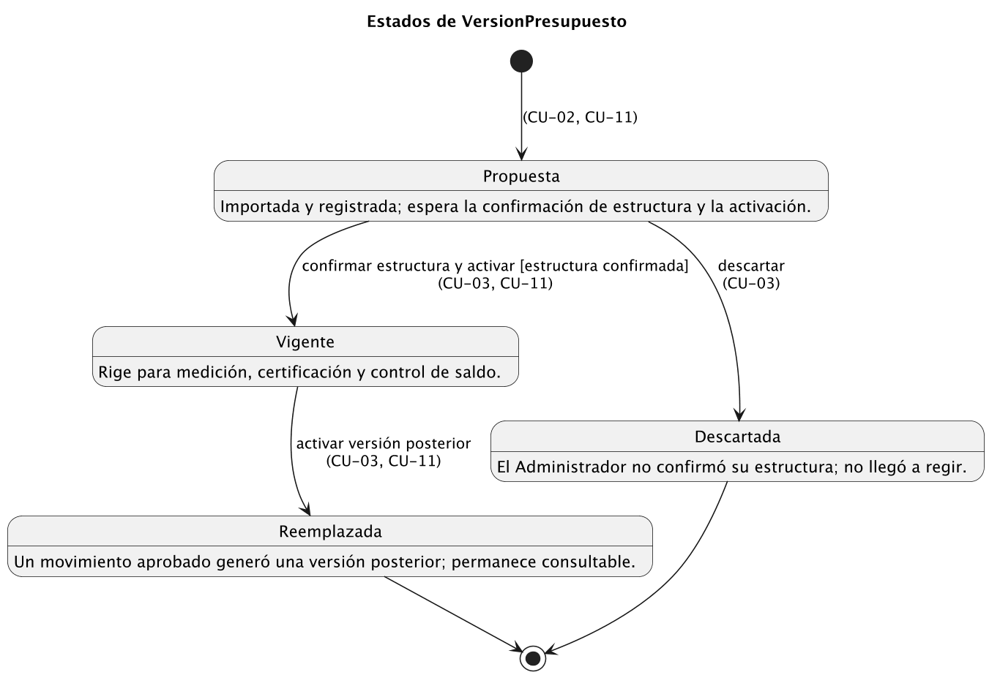
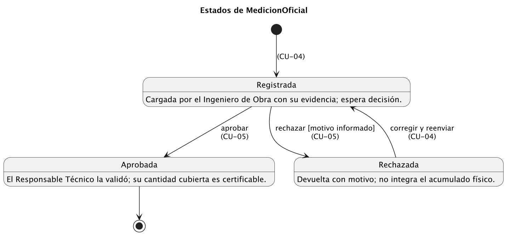
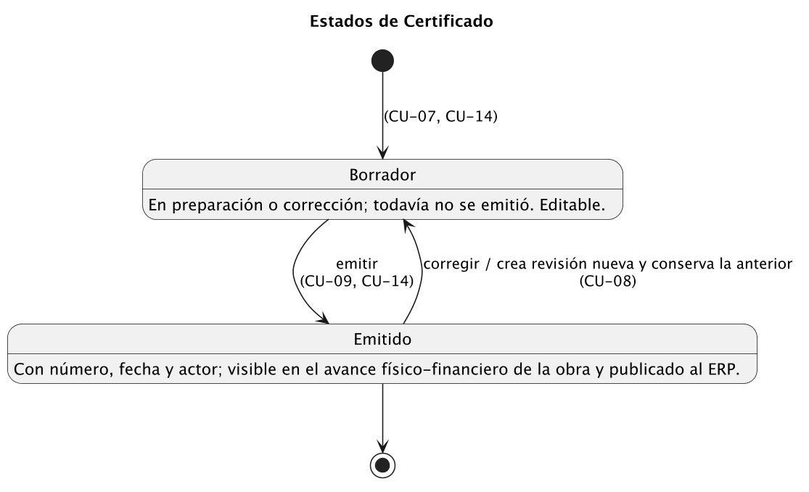
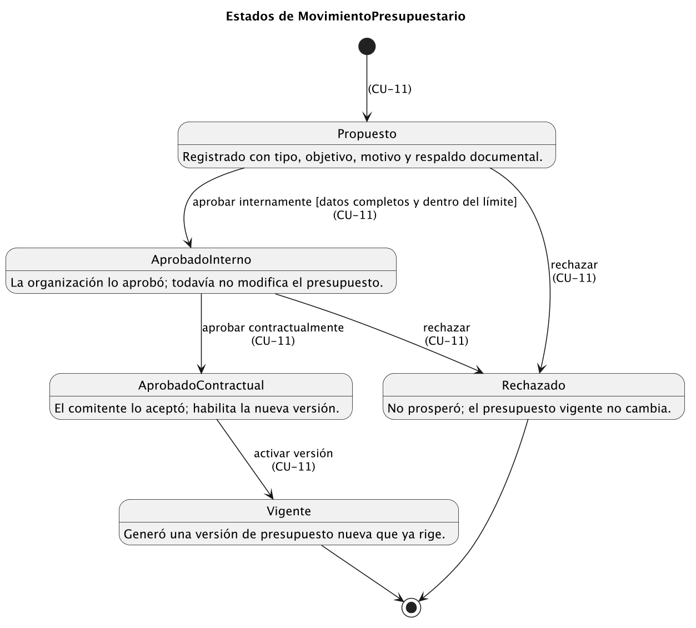
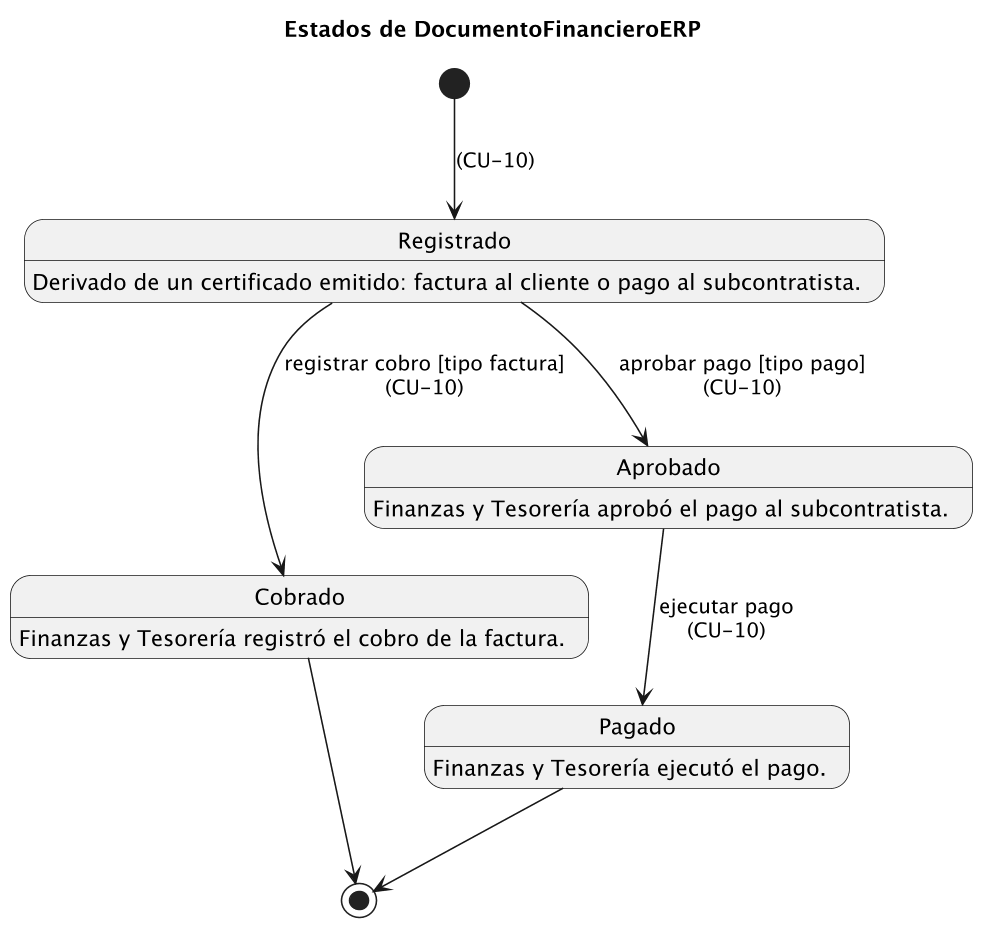
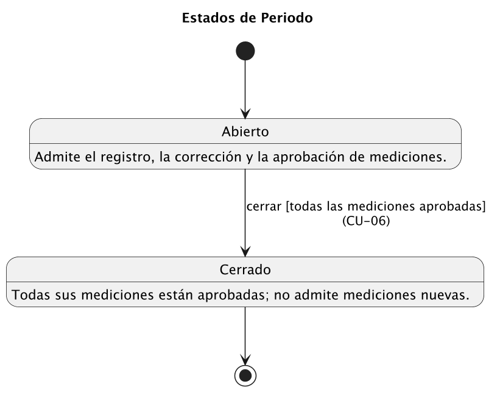
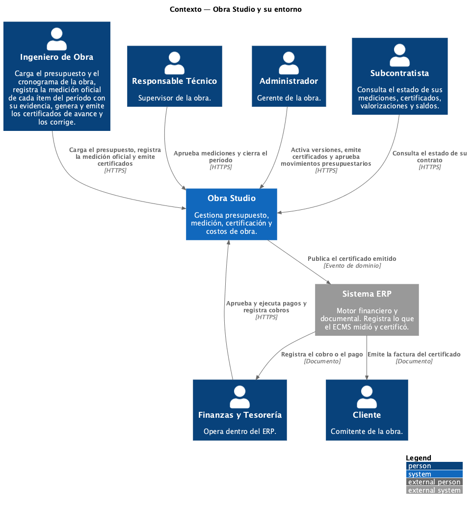
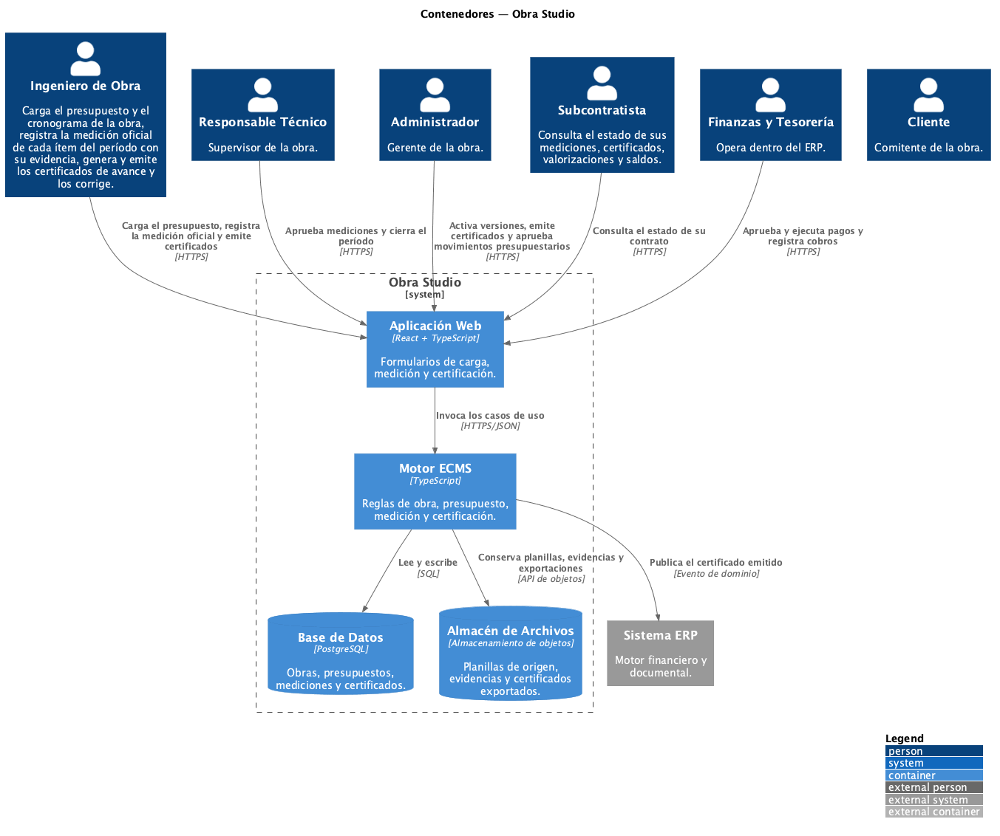
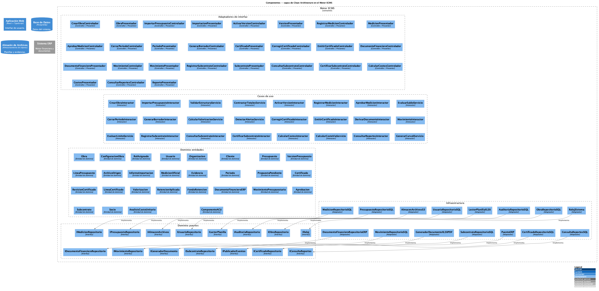

# Modelo de Análisis — Obra Studio

*Ingeniería del Software 2 · Trabajo Práctico Final · Dr. Emilio Gutiérrez Rodríguez*  
*Autores: Rojas, Sebastián · Taveira, Baltazar · Scotover, Leandro*

Este archivo acompaña a [requerimientos-consolidados.md](requerimientos-consolidados.md) y al entregable `TPF-Obra-Studio.docx`. Reúne lo que no entra en la plantilla de la cátedra: el catálogo de casos de uso, las máquinas de estado, las decisiones de modelado, las vistas de arquitectura y la trazabilidad con la implementación.

Todo su contenido y todos los diagramas se generan desde `modelo/modelo.yaml`, que es la única fuente de verdad. Para reproducirlos, ejecutar `modelo/build.sh`.

## 1. Alcance

| Módulo | Nombre | Situación |
|---|---|---|
| `ecms.budgets` | Presupuestos | Desarrollado |
| `ecms.acu` | Análisis de Costo Unitario | Desarrollado |
| `ecms.certifications` | Certificaciones | Desarrollado |
| `ecms.subcontracts` | Subcontratos | Desarrollado |
| `erp.invoices` | Facturas | Desarrollado |
| `erp.payments` | Pagos | Desarrollado |
| `ecms.stock` | — | Excluido: PR-07 excluye la operación de inventario y almacén. |
| `ecms.rrhh` | — | Excluido: Fuera del alcance de presupuesto, medición y certificación. |
| `ecms.partes` | — | Excluido: La vía C del motor de costos se documenta sin desarrollar partes diarios. |
| `erp.petty-cash` | — | Excluido: Compras menores no intervienen en la cadena de certificación. |
| `erp.finance` | — | Excluido: Contabilidad y tesorería se tratan como contexto de interacción ERP. |

## 2. Vocabulario

La columna «Clase» nombra la clase del modelo; «Implementación» indica su contraparte en el código, cuando existe.

| Término | Inglés | Clase | Implementación |
|---|---|---|---|
| Obra | work site | `Obra` | projects (fila) |
| Presupuesto | budget | `Presupuesto` | ProjectFile / budgets |
| Versión de presupuesto | budget version | `VersionPresupuesto` | budgets.revision + budget_operations |
| Rubro | chapter | `LineaPresupuesto` | CostItem.rowType='chapter' |
| Ítem | budget line | `LineaPresupuesto` | CostItem.rowType='begrotingspost' |
| ACU | unit cost analysis | `AnalisisCostoUnitario` | CostItem.acu + calculateAcu() |
| Medición oficial | official measurement | `MedicionOficial` | no implementado (especificado) |
| Período | period | `Periodo` | no implementado (especificado) |
| Certificado de avance | advance certificate | `Certificado` | no implementado (especificado) |
| Valorización | valuation | `Valorizacion` | extiende el wiki: importe calculado del certificado |
| Movimiento presupuestario | budget movement | `MovimientoPresupuestario` | budgets kind='adendas', capítulo AD-N |
| Subcontrato | subcontract | `Subcontrato` | no implementado (especificado) |
| Socio | partner | `Socio` | no implementado (especificado) |
| Curva S | S-curve | `—` | extiende el wiki: reporte derivado, sin tabla propia |
| Fondo de reparo | retention fund | `RetencionAplicada` | no implementado (especificado) |

## 3. Catálogo de casos de uso

| ID | Caso de uso | Subsistema | Actores | Requisitos |
|---|---|---|---|---|
| CU-01 | Crear obra y asignar responsables **(detallado)** | Presupuesto y Medición | Administrador | RF-01 |
| CU-02 | Importar presupuesto y cronograma **(detallado)** | Presupuesto y Medición | Ingeniero de Obra | RF-02, RF-03, RF-04, RF-06 |
| CU-03 | Confirmar estructura y activar versión vigente **(detallado)** | Presupuesto y Medición | Administrador | RF-05 |
| CU-04 | Registrar medición oficial **(detallado)** | Presupuesto y Medición | Ingeniero de Obra | RF-07, RF-10 |
| CU-05 | Aprobar o rechazar medición oficial **(detallado)** | Presupuesto y Medición | Responsable Técnico | RF-08, RF-09 |
| CU-06 | Cerrar período de medición **(detallado)** | Presupuesto y Medición | Responsable Técnico | RF-11 |
| CU-07 | Generar borrador de certificado **(detallado)** | Certificación y Subcontratos | Ingeniero de Obra | RF-09, RF-12, RF-13, RF-14, RF-15, RF-22 |
| CU-08 | Corregir certificado emitido **(detallado)** | Certificación y Subcontratos | Ingeniero de Obra | RF-16 |
| CU-09 | Emitir certificado de avance **(detallado)** | Certificación y Subcontratos | Ingeniero de Obra, Administrador | RF-17, RF-18 |
| CU-10 | Derivar documento financiero en ERP **(detallado)** | Certificación y Subcontratos | Motor de Ingeniería, Motor ERP, Finanzas y Tesorería, Cliente | RF-14, RF-18 |
| CU-11 | Proponer y aprobar movimiento presupuestario **(detallado)** | Presupuesto y Medición | Administrador, Responsable Técnico, Cliente | RF-06, RF-09, RF-19, RF-20, RF-21, RF-22 |
| CU-12 | Registrar contrato de subcontrato **(detallado)** | Certificación y Subcontratos | Administrador | RF-23 |
| CU-13 | Consultar estado del subcontrato **(detallado)** | Certificación y Subcontratos | Subcontratista | RF-24 |
| CU-14 | Certificar y valorizar subcontrato **(detallado)** | Certificación y Subcontratos | Responsable Técnico, Subcontratista, Motor ERP | RF-10, RF-25 |
| CU-15 | Calcular costos por vía **(detallado)** | Presupuesto y Medición | Ingeniero de Obra, Motor de Ingeniería | RF-26 |
| CU-16 | Consultar reportes y Curva S **(detallado)** | Certificación y Subcontratos | Administrador, Responsable Técnico | RF-27, RF-28 |

Relaciones entre casos de uso:

- `CU-09` **«include»** `CU-10`
- `CU-14` **«include»** `CU-10`
- `CU-11` **«extend»** `CU-05`

Generalización de actores (los padres son abstractos y no tienen casos de uso propios):

- **Usuario de Obra** ← Ingeniero de Obra, Responsable Técnico, Administrador. Usuario interno con rol vigente sobre la obra. Agrupa el acceso común que exige RNF-01: organización, pertenencia a la obra y rol se comprueban antes de leer o modificar información.
- **Motor de Obra Studio** ← Motor de Ingeniería, Motor ERP. Proceso que un motor de Obra Studio ejecuta sin intervención de un usuario: el cálculo por vía, la publicación del certificado emitido y la derivación del documento financiero (D-15).

## 4. Máquinas de estado

### VersionPresupuesto



| Estado | Significado |
|---|---|
| Propuesta | Importada y registrada; espera la confirmación de estructura y la activación. |
| Vigente | Rige para medición, certificación y control de saldo. |
| Reemplazada | Un movimiento aprobado generó una versión posterior; permanece consultable. |
| Descartada | El Administrador no confirmó su estructura; no llegó a regir. |

| Desde | Evento | Guarda | Hacia | Caso de uso |
|---|---|---|---|---|
| Propuesta | confirmar estructura y activar | estructura confirmada | Vigente | CU-03, CU-11 |
| Propuesta | descartar | — | Descartada | CU-03 |
| Vigente | activar versión posterior | — | Reemplazada | CU-03, CU-11 |

### MedicionOficial



| Estado | Significado |
|---|---|
| Registrada | Cargada por el Ingeniero de Obra con su evidencia; espera decisión. |
| Aprobada | El Responsable Técnico la validó; su cantidad cubierta es certificable. |
| Rechazada | Devuelta con motivo; no integra el acumulado físico. |

| Desde | Evento | Guarda | Hacia | Caso de uso |
|---|---|---|---|---|
| Registrada | aprobar | — | Aprobada | CU-05 |
| Registrada | rechazar | motivo informado | Rechazada | CU-05 |
| Rechazada | corregir y reenviar | — | Registrada | CU-04 |

### Certificado



| Estado | Significado |
|---|---|
| Borrador | En preparación o corrección; todavía no se emitió. Editable. |
| Emitido | Con número, fecha y actor; visible en el avance físico-financiero de la obra y publicado al ERP. |

| Desde | Evento | Guarda | Hacia | Caso de uso |
|---|---|---|---|---|
| Borrador | emitir | — | Emitido | CU-09, CU-14 |
| Emitido | corregir / crea revisión nueva y conserva la anterior | — | Borrador | CU-08 |

### MovimientoPresupuestario



| Estado | Significado |
|---|---|
| Propuesto | Registrado con tipo, objetivo, motivo y respaldo documental. |
| AprobadoInterno | La organización lo aprobó; todavía no modifica el presupuesto. |
| AprobadoContractual | El comitente lo aceptó; habilita la nueva versión. |
| Vigente | Generó una versión de presupuesto nueva que ya rige. |
| Rechazado | No prosperó; el presupuesto vigente no cambia. |

| Desde | Evento | Guarda | Hacia | Caso de uso |
|---|---|---|---|---|
| Propuesto | aprobar internamente | datos completos y dentro del límite | AprobadoInterno | CU-11 |
| Propuesto | rechazar | — | Rechazado | CU-11 |
| AprobadoInterno | aprobar contractualmente | — | AprobadoContractual | CU-11 |
| AprobadoInterno | rechazar | — | Rechazado | CU-11 |
| AprobadoContractual | activar versión | — | Vigente | CU-11 |

### DocumentoFinancieroERP



| Estado | Significado |
|---|---|
| Registrado | Derivado de un certificado emitido: factura al cliente o pago al subcontratista. |
| Cobrado | Finanzas y Tesorería registró el cobro de la factura. |
| Aprobado | Finanzas y Tesorería aprobó el pago al subcontratista. |
| Pagado | Finanzas y Tesorería ejecutó el pago. |

| Desde | Evento | Guarda | Hacia | Caso de uso |
|---|---|---|---|---|
| Registrado | registrar cobro | tipo factura | Cobrado | CU-10 |
| Registrado | aprobar pago | tipo pago | Aprobado | CU-10 |
| Aprobado | ejecutar pago | — | Pagado | CU-10 |

### Periodo



| Estado | Significado |
|---|---|
| Abierto | Admite el registro, la corrección y la aprobación de mediciones. |
| Cerrado | Todas sus mediciones están aprobadas; no admite mediciones nuevas. |

| Desde | Evento | Guarda | Hacia | Caso de uso |
|---|---|---|---|---|
| Abierto | cerrar | todas las mediciones aprobadas | Cerrado | CU-06 |

## 5. Decisiones de modelado

Cada fila es una discrepancia hallada entre el catálogo de requerimientos y la documentación de dominio, con la resolución adoptada.

### D-01 — Términos ausentes en la documentación de dominio

**Hallazgo.** «Valorización» y «Curva S» no aparecen en ninguna versión de la documentación de Obra Studio.

**Resolución.** Se conservan como requisitos (RF-13, RF-25 y RF-27) y se declaran en la tabla de vocabulario como alcance que extiende el dominio documentado. Valorización designa el importe calculado del certificado; Curva S es un reporte derivado que no agrega tabla propia.

### D-02 — Aditivos y deductivos

**Hallazgo.** El catálogo habla de aditivos y deductivos; la documentación de dominio no usa esos términos.

**Resolución.** Se unifican en MovimientoPresupuestario con tipo AMPLIACION, DEDUCCION o VARIACION_PRECIO, que es el vocabulario del dominio.

### D-03 — Rol de responsable técnico

**Hallazgo.** El catálogo nombra un «responsable técnico» que no existe como rol en el dominio.

**Resolución.** Se asimila al Supervisor de la obra: es el actor que aprueba o rechaza las mediciones y cierra el período. Es un actor, no un rol: en el sistema opera como miembro o admin (D-08).

### D-04 — Idempotencia de la importación

**Hallazgo.** RNF-07 exige que recargar el mismo XLSX no cree otra versión, pero la implementación actual calcula el hash sobre el documento ya confirmado y no sobre el archivo.

**Resolución.** ArchivoOrigen declara hashSHA256 sobre el contenido del archivo y la importación lo consulta antes de crear una versión, de modo que el requisito se cumple tal como está enunciado.

### D-05 — Doble conteo de trabajo físico

**Hallazgo.** RF-10 exige impedir que una misma cantidad se contabilice dos veces, sin indicar el mecanismo.

**Resolución.** Existe una sola MedicionOficial por ítem y período, con el ejecutor como atributo en lugar de un registro separado para el subcontratista. El acumulado se incrementa una sola vez por construcción del modelo, no por una validación añadida.

### D-06 — Estados del movimiento presupuestario

**Hallazgo.** RF-21 exige aprobación interna y contractual separadas; el dominio no define estados para el movimiento.

**Resolución.** Se diseña el ciclo Propuesto, AprobadoInterno, AprobadoContractual y Vigente, más Rechazado. Solo la transición a Vigente genera una versión de presupuesto nueva.

### D-07 — Estados del certificado

**Hallazgo.** La documentación describe el certificado con tres, cuatro y cinco estados según el documento, y trata el rechazo unas veces como estado y otras como transición. El modelo anterior además cerraba el certificado al cerrar el período, aunque la emisión exigía el período ya cerrado.

**Resolución.** El certificado es un registro de avance, no un trámite: tiene dos estados, Borrador y Emitido, y no se cierra por período. Corregir un certificado emitido crea una revisión nueva en Borrador vinculada a la anterior, que se conserva. Su tipo es interno o subcontrato: los ítems de una adenda se certifican dentro del mismo certificado de avance (D-17). El interno se refleja en el avance físico-financiero de la obra y origina la factura al cliente.

### D-08 — Modelo de permisos

**Hallazgo.** Una parte de la documentación define una matriz de roles y otra afirma que la aplicación no debe definir ningún rol.

**Resolución.** Se adopta un conjunto mínimo de roles, porque RNF-01 exige comprobar el rol: admin, miembro y visualizador, más miembro ERP (contadores) y miembro ECMS (asistente o fiscalizador de campo). Un actor no es un rol: el Ingeniero de Obra opera como miembro, el Responsable Técnico como miembro o admin, el Administrador (gerente) como admin, un auditor como visualizador y Finanzas y Tesorería como miembro ERP. El Subcontratista accede solo a su contrato (RNF-02). No se impone separación de funciones entre roles.

### D-09 — Propiedad del contrato de subcontrato

**Hallazgo.** Un documento asigna el contrato al ERP y otro al ECMS.

**Resolución.** Se aplica la regla de propiedad por naturaleza del registro: el hecho de campo pertenece al ECMS y el documento legal al ERP. El contrato es del ERP; el certificado, del ECMS.

### D-10 — Persistencia del árbol de presupuesto

**Hallazgo.** La implementación guarda el presupuesto como documento JSON y no como tablas normalizadas.

**Resolución.** El diagrama de entidad relación presenta el modelo normalizado, que es lo que corresponde al modelo de diseño. El almacenamiento documental se documenta como decisión de implementación y no altera el modelo conceptual.

### D-11 — Atributos derivados

**Hallazgo.** Importes como el acumulado certificado o el saldo podrían almacenarse y quedar desfasados.

**Resolución.** Se marcan como derivados en el diagrama de clases y se omiten como columnas en el diagrama de entidad relación: se calculan desde los registros aprobados y no pueden discrepar de su origen.

### D-12 — Alcance del trabajo

**Hallazgo.** Obra Studio no tiene ningún módulo de taller ni de fabricación, ni en la documentación ni en el catálogo de módulos de la implementación.

**Resolución.** No hay nada que excluir por ese concepto. El alcance se acota explícitamente a seis módulos y se declaran los excluidos con su motivo.

### D-13 — Activación de la versión de presupuesto

**Hallazgo.** CU-03 figuraba con el Administrador, pero CU-02 lo incluía y su flujo hacía que el Ingeniero de Obra solicitara la activación.

**Resolución.** Se separan: CU-02 termina con la versión en Propuesta y CU-03, del Administrador, confirma la estructura (RF-05) y la activa o la descarta. Se quita el include CU-02 → CU-03, porque activar es una meta propia del Administrador y no un paso común de varios casos.

### D-14 — Relaciones entre casos de uso de certificación

**Hallazgo.** CU-09 incluía CU-07 aunque su precondición exige que el borrador ya exista, y CU-08 extendía CU-09 aunque la corrección ocurre después de la emisión.

**Resolución.** Se quitan ambas relaciones: generar el borrador (CU-07) y corregir un emitido (CU-08) son metas propias que preceden o siguen a la emisión. Se mantienen CU-09 y CU-14 incluyendo CU-10 (subobjetivo común sin actor humano propio) y CU-11 extendiendo CU-05 en el exceso sobre saldo.

### D-15 — Motores ECMS y ERP como actores

**Hallazgo.** El modelo de casos de uso declara al Motor de Ingeniería (CU-10, CU-15) y al Motor ERP (CU-10, CU-14) como actores sistema, mientras las vistas C4 los ubican como contenedores de Obra Studio.

**Resolución.** Se mantienen como actores de tipo sistema, marcados interno, para representar los procesos que cada motor ejecuta sin intervención de un usuario: el cálculo por vía, la publicación del evento y la derivación de facturas y pagos. La vista C4 describe la estructura y no los objetivos, por eso los ubica dentro del sistema.

### D-16 — Requisitos redefinidos respecto del catálogo

**Hallazgo.** RF-16, RF-17, RF-22 y RNF-05 suponían un certificado con revisión por dos personas, cierre y reapertura autorizada; las excepciones de CU-09 citaban RNF-06 sin que el catálogo lo marcara; RF-24 hacía que el subcontratista presentara mediciones que mide y carga el Ingeniero de Obra.

**Resolución.** Se redefinen RF-16, RF-17, RF-22 y RNF-05 para el certificado de dos estados y los roles mínimos (D-07, D-08): RF-16 corrige mediante revisión nueva, RF-17 limita quién emite, RF-22 conserva solo la certificación de pendientes cubiertos y RNF-05 habla de certificados emitidos. RNF-06 se marca en CU-09, que calcula la valorización. RF-24 queda como consulta del subcontratista y RNF-09 deja de marcarse en CU-13, que ya no tiene formulario de medición (D-18).

### D-17 — Adendas y facturación al cliente

**Hallazgo.** No estaba definido cómo se certifica una adenda ni desde qué certificado factura el ERP al cliente. Una adenda no siempre es un pedido del cliente: el exceso medido puede deberse a un retrabajo, un atraso, un fallo o un cambio.

**Resolución.** La adenda no tiene certificado propio: sus ítems se miden como cualquier otro y se certifican en el mismo certificado de avance, validados contra el presupuesto vigente (presupuesto más movimientos). El exceso sobre el saldo se detecta en CU-05 como sobrecosto (PropuestaPendiente) y en CU-11 se clasifica por causa: adenda, cubierta por un MovimientoPresupuestario, o retrabajo, atraso, fallo o cambio. El ERP factura al cliente a partir del certificado interno.

### D-18 — Medición del trabajo subcontratado

**Hallazgo.** CU-13 hacía que el Subcontratista presentara mediciones, mientras D-05 establece una sola MedicionOficial por ítem y período, con el ejecutor como atributo.

**Resolución.** El Ingeniero de Obra mide en terreno lo ejecutado por el subcontratista y lo registra en CU-04 con ejecutor subcontratado. CU-13 pasa a «Consultar estado del subcontrato» y RF-24 se redefine como consulta (D-16).

### D-19 — Facturas y pagos dentro del sistema

**Hallazgo.** El alcance incluía los módulos erp.invoices y erp.payments, pero las vistas C4 y el catálogo de actores trataban al ERP como sistema externo.

**Resolución.** Facturas y pagos son parte de Obra Studio: el ERP es un contenedor del sistema (Motor ERP) y se modela el ciclo del DocumentoFinancieroERP: Registrado, y luego Cobrado si es factura o Aprobado y Pagado si es pago, a cargo de Finanzas y Tesorería en CU-10.

### D-20 — Generalización de actores

**Hallazgo.** La plantilla pide un diagrama de generalización de actores, pero el modelo no declaraba jerarquía. Un actor hijo hereda todos los casos de uso del padre, de modo que una jerarquía con casos propios del padre daría a cada hijo metas que no tiene.

**Resolución.** Se declaran dos padres abstractos sin casos de uso propios: Usuario de Obra, que agrupa al Ingeniero de Obra, al Responsable Técnico y al Administrador por el acceso común de RNF-01, y Motor de Obra Studio, que agrupa a los dos motores que actúan sin usuario (D-15). Subcontratista, Cliente y Finanzas y Tesorería no generalizan: su acceso es distinto (RNF-02, PR-06).

### D-21 — Estados del período de medición

**Hallazgo.** RF-11 y RNF-03 hablan de cerrar el período y de no dejarlo parcialmente cerrado, y la entidad declara el atributo estado, pero el modelo no tenía su máquina de estados; CU-04 y CU-06 la necesitan en sus precondiciones.

**Resolución.** Se declara el ciclo Abierto y Cerrado: el cierre ocurre en CU-06 con todas las mediciones aprobadas y es atómico. Ningún caso de uso abre períodos; su apertura queda fuera del alcance del catálogo.

## 6. Arquitectura

El Motor ECMS aplica Clean Architecture en cuatro anillos; las dependencias apuntan siempre hacia adentro. Los estereotipos de análisis son su proyección en UML:

| Estereotipo UML | Anillo | Responsabilidad |
|---|---|---|
| `«Boundary»` | Adaptadores de interfaz | Traduce la petición y presenta el resultado. |
| `«Control»` | Casos de uso | Orquesta entidades y puertos. |
| `«Entity»` | Dominio | Concentra la regla de negocio y sus invariantes. |
| `«Interface»` | Dominio (puertos) | Invierte la dependencia hacia la infraestructura. |

Puertos declarados por el dominio:

| Puerto | Operaciones | Adaptador |
|---|---|---|
| `IPresupuestoRepositorio` | `buscarVersionVigente(obraId)`, `buscarVersion(versionId)`, `buscarPorHash(hash)`, `guardarVersion(version)`, `listarACU(obraId)` | `PresupuestoRepositorioSQL` |
| `IAlmacenArchivos` | `guardar(archivo)`, `recuperar(ruta)` | `AlmacenArchivosS3` |
| `ILectorPlanilla` | `leer(archivo)`, `detectarEstructura(hojas)` | `LectorPlanillaXLSX` |
| `IMedicionRepositorio` | `listarPorPeriodo(periodoId)`, `listarPorSubcontrato(subcontratoId)`, `buscarPorItem(lineaId, periodoId)`, `guardar(medicion)`, `acumuladoAprobado(lineaId)`, `buscarPeriodo(periodoId)`, `guardarPeriodo(periodo)` | `MedicionRepositorioSQL` |
| `ICertificadoRepositorio` | `buscarRevision(revisionId)`, `listarPorSubcontrato(subcontratoId)`, `guardar(certificado)`, `siguienteNumero(obraId)` | `CertificadoRepositorioSQL` |
| `IGeneradorDocumento` | `exportar(revision, formato)` | `GeneradorDocumentoXLSXPDF` |
| `IPublicadorEventos` | `publicar(evento)` | `PuenteERP` |
| `IAuditoriaRepositorio` | `registrar(entrada)` | `AuditoriaRepositorioSQL` |
| `IReloj` | `ahora()` | `RelojSistema` |
| `IObraRepositorio` | `existeCodigo(codigo)`, `guardar(obra)` | `ObraRepositorioSQL` |
| `IUsuarioRepositorio` | `listarMiembros(organizacionId)` | `UsuarioRepositorioSQL` |
| `IMovimientoRepositorio` | `buscar(movimientoId)`, `guardar(movimiento)` | `MovimientoRepositorioSQL` |
| `ISubcontratoRepositorio` | `buscar(subcontratoId)`, `listarSocios(organizacionId)`, `guardar(subcontrato)` | `SubcontratoRepositorioSQL` |
| `IDocumentoFinancieroRepositorio` | `buscarPorCertificado(certificadoId)`, `guardar(documento)` | `DocumentoFinancieroRepositorioERP` |
| `IConsultaReportes` | `avanceFisico(obraId, fechaCorte)`, `avanceFinanciero(obraId, fechaCorte)`, `pendienteDeMovimiento(obraId, fechaCorte)`, `resumenPorRubro(obraId, fechaCorte)`, `respaldo(cifraId)` | `ConsultaReportesSQL` |

Vistas C4 generadas con C4-PlantUML (`modelo/gen/gen_c4.py`, salida en `modelo/out/c4/`):


**Contexto.** Obra Studio y su entorno.



**Contenedores.** Estructura interna de Obra Studio.



**Componentes.** Los cuatro anillos de Clean Architecture dentro del Motor ECMS.



Cada caso de uso tiene además su contexto, sus contenedores y su vista dinámica C4; el documento los ubica en la sección de cada caso (ver la tabla siguiente).


Figuras del entregable en el orden de la plantilla (`modelo/gen/plan.py`). El modelo conceptual (`modelo/out/modelo-conceptual.png`) se genera como apoyo y no integra el documento.

| Figura | Archivo | Diagrama |
|---|---|---|
| 1 | `modelo/out/casos-de-uso-alto-nivel.png` | Casos de uso de alto nivel de Obra Studio, agrupados por procesos. |
| 2 | `modelo/out/generalizacion-actores.png` | Generalización de actores. |
| 3 | `modelo/out/casos-de-uso-A.png` | Casos de uso del subsistema Presupuesto y Medición. |
| 4 | `modelo/out/casos-de-uso-B.png` | Casos de uso del subsistema Certificación y Subcontratos. |
| 5 | `modelo/out/c4/C4-CU01-contexto.png` | Contexto C4 del caso de uso CU-01. |
| 6 | `modelo/out/c4/C4-CU01-contenedores.png` | Contenedores C4 que intervienen en CU-01. |
| 7 | `modelo/out/CU-01-clases.png` | Clases del caso de uso CU-01. |
| 8 | `modelo/out/CU-01-secuencia.png` | Interacción del caso de uso CU-01. |
| 9 | `modelo/out/c4/C4-CU01.png` | Vista dinámica C4 de CU-01 entre componentes. |
| 10 | `modelo/out/CU-01-actividades.png` | Actividades del caso de uso CU-01, con sus caminos alternativos y de excepción. |
| 11 | `modelo/out/c4/C4-CU02-contexto.png` | Contexto C4 del caso de uso CU-02. |
| 12 | `modelo/out/c4/C4-CU02-contenedores.png` | Contenedores C4 que intervienen en CU-02. |
| 13 | `modelo/out/CU-02-clases.png` | Clases del caso de uso CU-02. |
| 14 | `modelo/out/CU-02-secuencia.png` | Interacción del caso de uso CU-02. |
| 15 | `modelo/out/c4/C4-CU02.png` | Vista dinámica C4 de CU-02 entre componentes. |
| 16 | `modelo/out/CU-02-actividades.png` | Actividades del caso de uso CU-02, con sus caminos alternativos y de excepción. |
| 17 | `modelo/out/c4/C4-CU03-contexto.png` | Contexto C4 del caso de uso CU-03. |
| 18 | `modelo/out/c4/C4-CU03-contenedores.png` | Contenedores C4 que intervienen en CU-03. |
| 19 | `modelo/out/CU-03-clases.png` | Clases del caso de uso CU-03. |
| 20 | `modelo/out/CU-03-secuencia.png` | Interacción del caso de uso CU-03. |
| 21 | `modelo/out/c4/C4-CU03.png` | Vista dinámica C4 de CU-03 entre componentes. |
| 22 | `modelo/out/CU-03-actividades.png` | Actividades del caso de uso CU-03, con sus caminos alternativos y de excepción. |
| 23 | `modelo/out/estado-VersionPresupuesto.png` | Estados de VersionPresupuesto. |
| 24 | `modelo/out/c4/C4-CU04-contexto.png` | Contexto C4 del caso de uso CU-04. |
| 25 | `modelo/out/c4/C4-CU04-contenedores.png` | Contenedores C4 que intervienen en CU-04. |
| 26 | `modelo/out/CU-04-clases.png` | Clases del caso de uso CU-04. |
| 27 | `modelo/out/CU-04-secuencia.png` | Interacción del caso de uso CU-04. |
| 28 | `modelo/out/c4/C4-CU04.png` | Vista dinámica C4 de CU-04 entre componentes. |
| 29 | `modelo/out/CU-04-actividades.png` | Actividades del caso de uso CU-04, con sus caminos alternativos y de excepción. |
| 30 | `modelo/out/c4/C4-CU05-contexto.png` | Contexto C4 del caso de uso CU-05. |
| 31 | `modelo/out/c4/C4-CU05-contenedores.png` | Contenedores C4 que intervienen en CU-05. |
| 32 | `modelo/out/CU-05-clases.png` | Clases del caso de uso CU-05. |
| 33 | `modelo/out/CU-05-secuencia.png` | Interacción del caso de uso CU-05. |
| 34 | `modelo/out/c4/C4-CU05.png` | Vista dinámica C4 de CU-05 entre componentes. |
| 35 | `modelo/out/CU-05-actividades.png` | Actividades del caso de uso CU-05, con sus caminos alternativos y de excepción. |
| 36 | `modelo/out/estado-MedicionOficial.png` | Estados de MedicionOficial. |
| 37 | `modelo/out/c4/C4-CU06-contexto.png` | Contexto C4 del caso de uso CU-06. |
| 38 | `modelo/out/c4/C4-CU06-contenedores.png` | Contenedores C4 que intervienen en CU-06. |
| 39 | `modelo/out/CU-06-clases.png` | Clases del caso de uso CU-06. |
| 40 | `modelo/out/CU-06-secuencia.png` | Interacción del caso de uso CU-06. |
| 41 | `modelo/out/c4/C4-CU06.png` | Vista dinámica C4 de CU-06 entre componentes. |
| 42 | `modelo/out/CU-06-actividades.png` | Actividades del caso de uso CU-06, con sus caminos alternativos y de excepción. |
| 43 | `modelo/out/estado-Periodo.png` | Estados de Periodo. |
| 44 | `modelo/out/c4/C4-CU07-contexto.png` | Contexto C4 del caso de uso CU-07. |
| 45 | `modelo/out/c4/C4-CU07-contenedores.png` | Contenedores C4 que intervienen en CU-07. |
| 46 | `modelo/out/CU-07-clases.png` | Clases del caso de uso CU-07. |
| 47 | `modelo/out/CU-07-secuencia.png` | Interacción del caso de uso CU-07. |
| 48 | `modelo/out/c4/C4-CU07.png` | Vista dinámica C4 de CU-07 entre componentes. |
| 49 | `modelo/out/CU-07-actividades.png` | Actividades del caso de uso CU-07, con sus caminos alternativos y de excepción. |
| 50 | `modelo/out/c4/C4-CU08-contexto.png` | Contexto C4 del caso de uso CU-08. |
| 51 | `modelo/out/c4/C4-CU08-contenedores.png` | Contenedores C4 que intervienen en CU-08. |
| 52 | `modelo/out/CU-08-clases.png` | Clases del caso de uso CU-08. |
| 53 | `modelo/out/CU-08-secuencia.png` | Interacción del caso de uso CU-08. |
| 54 | `modelo/out/c4/C4-CU08.png` | Vista dinámica C4 de CU-08 entre componentes. |
| 55 | `modelo/out/CU-08-actividades.png` | Actividades del caso de uso CU-08, con sus caminos alternativos y de excepción. |
| 56 | `modelo/out/c4/C4-CU09-contexto.png` | Contexto C4 del caso de uso CU-09. |
| 57 | `modelo/out/c4/C4-CU09-contenedores.png` | Contenedores C4 que intervienen en CU-09. |
| 58 | `modelo/out/CU-09-clases.png` | Clases del caso de uso CU-09. |
| 59 | `modelo/out/CU-09-secuencia.png` | Interacción del caso de uso CU-09. |
| 60 | `modelo/out/c4/C4-CU09.png` | Vista dinámica C4 de CU-09 entre componentes. |
| 61 | `modelo/out/estado-Certificado.png` | Estados de Certificado. |
| 62 | `modelo/out/c4/C4-CU10-contexto.png` | Contexto C4 del caso de uso CU-10. |
| 63 | `modelo/out/c4/C4-CU10-contenedores.png` | Contenedores C4 que intervienen en CU-10. |
| 64 | `modelo/out/CU-10-clases.png` | Clases del caso de uso CU-10. |
| 65 | `modelo/out/CU-10-secuencia.png` | Interacción del caso de uso CU-10. |
| 66 | `modelo/out/c4/C4-CU10.png` | Vista dinámica C4 de CU-10 entre componentes. |
| 67 | `modelo/out/CU-10-actividades.png` | Actividades del caso de uso CU-10, con sus caminos alternativos y de excepción. |
| 68 | `modelo/out/estado-DocumentoFinancieroERP.png` | Estados de DocumentoFinancieroERP. |
| 69 | `modelo/out/c4/C4-CU11-contexto.png` | Contexto C4 del caso de uso CU-11. |
| 70 | `modelo/out/c4/C4-CU11-contenedores.png` | Contenedores C4 que intervienen en CU-11. |
| 71 | `modelo/out/CU-11-clases.png` | Clases del caso de uso CU-11. |
| 72 | `modelo/out/CU-11-secuencia.png` | Interacción del caso de uso CU-11. |
| 73 | `modelo/out/c4/C4-CU11.png` | Vista dinámica C4 de CU-11 entre componentes. |
| 74 | `modelo/out/CU-11-actividades.png` | Actividades del caso de uso CU-11, con sus caminos alternativos y de excepción. |
| 75 | `modelo/out/estado-MovimientoPresupuestario.png` | Estados de MovimientoPresupuestario. |
| 76 | `modelo/out/c4/C4-CU12-contexto.png` | Contexto C4 del caso de uso CU-12. |
| 77 | `modelo/out/c4/C4-CU12-contenedores.png` | Contenedores C4 que intervienen en CU-12. |
| 78 | `modelo/out/CU-12-clases.png` | Clases del caso de uso CU-12. |
| 79 | `modelo/out/CU-12-secuencia.png` | Interacción del caso de uso CU-12. |
| 80 | `modelo/out/c4/C4-CU12.png` | Vista dinámica C4 de CU-12 entre componentes. |
| 81 | `modelo/out/CU-12-actividades.png` | Actividades del caso de uso CU-12, con sus caminos alternativos y de excepción. |
| 82 | `modelo/out/c4/C4-CU13-contexto.png` | Contexto C4 del caso de uso CU-13. |
| 83 | `modelo/out/c4/C4-CU13-contenedores.png` | Contenedores C4 que intervienen en CU-13. |
| 84 | `modelo/out/CU-13-clases.png` | Clases del caso de uso CU-13. |
| 85 | `modelo/out/CU-13-secuencia.png` | Interacción del caso de uso CU-13. |
| 86 | `modelo/out/c4/C4-CU13.png` | Vista dinámica C4 de CU-13 entre componentes. |
| 87 | `modelo/out/CU-13-actividades.png` | Actividades del caso de uso CU-13, con sus caminos alternativos y de excepción. |
| 88 | `modelo/out/c4/C4-CU14-contexto.png` | Contexto C4 del caso de uso CU-14. |
| 89 | `modelo/out/c4/C4-CU14-contenedores.png` | Contenedores C4 que intervienen en CU-14. |
| 90 | `modelo/out/CU-14-clases.png` | Clases del caso de uso CU-14. |
| 91 | `modelo/out/CU-14-secuencia.png` | Interacción del caso de uso CU-14. |
| 92 | `modelo/out/c4/C4-CU14.png` | Vista dinámica C4 de CU-14 entre componentes. |
| 93 | `modelo/out/CU-14-actividades.png` | Actividades del caso de uso CU-14, con sus caminos alternativos y de excepción. |
| 94 | `modelo/out/c4/C4-CU15-contexto.png` | Contexto C4 del caso de uso CU-15. |
| 95 | `modelo/out/c4/C4-CU15-contenedores.png` | Contenedores C4 que intervienen en CU-15. |
| 96 | `modelo/out/CU-15-clases.png` | Clases del caso de uso CU-15. |
| 97 | `modelo/out/CU-15-secuencia.png` | Interacción del caso de uso CU-15. |
| 98 | `modelo/out/c4/C4-CU15.png` | Vista dinámica C4 de CU-15 entre componentes. |
| 99 | `modelo/out/CU-15-actividades.png` | Actividades del caso de uso CU-15, con sus caminos alternativos y de excepción. |
| 100 | `modelo/out/c4/C4-CU16-contexto.png` | Contexto C4 del caso de uso CU-16. |
| 101 | `modelo/out/c4/C4-CU16-contenedores.png` | Contenedores C4 que intervienen en CU-16. |
| 102 | `modelo/out/CU-16-clases.png` | Clases del caso de uso CU-16. |
| 103 | `modelo/out/CU-16-secuencia.png` | Interacción del caso de uso CU-16. |
| 104 | `modelo/out/c4/C4-CU16.png` | Vista dinámica C4 de CU-16 entre componentes. |
| 105 | `modelo/out/CU-16-actividades.png` | Actividades del caso de uso CU-16, con sus caminos alternativos y de excepción. |
| 106 | `modelo/out/clases-persistentes-A.png` | Clases persistentes (A): obra y presupuesto. |
| 107 | `modelo/out/clases-persistentes-B.png` | Clases persistentes (B): medición y certificación. |
| 108 | `modelo/out/entidad-relacion.png` | Diagrama de entidad relación. |

## 7. Trazabilidad con la implementación

El motor de presupuesto está implementado; certificaciones y subcontratos están especificados en la documentación de dominio pero no implementados. Los diagramas de este trabajo son modelo de diseño, no transcripción del código.

| Clase del modelo | Situación | Contraparte |
|---|---|---|
| `Obra` | Implementado | Fila de la tabla projects. |
| `Presupuesto` | Implementado | Tabla budgets, con tipo cliente, costo o adendas. |
| `VersionPresupuesto` | Implementado | Columna revision más el diario inmutable budget_operations. |
| `LineaPresupuesto` | Implementado | CostItem dentro del documento del presupuesto. |
| `AnalisisCostoUnitario` | Implementado | Partida marcada como ACU y su cálculo. |
| `ArchivoOrigen` | Implementado | Importación con hash del contenido. |
| `InformeImportacion` | Implementado | Informe de importación con totales declarado y recalculado. |
| `MedicionOficial` | Especificado | Documentada en el dominio; sin implementación. |
| `Periodo` | Especificado | Documentada en el dominio; sin implementación. |
| `Certificado` | Especificado | Módulo de certificaciones presente en el catálogo, sin implementación. |
| `Subcontrato` | Especificado | Módulo de subcontratos presente en el catálogo, sin implementación. |
| `DocumentoFinancieroERP` | Especificado | Factura al cliente y pago al subcontratista; dentro del alcance del modelo, sin implementación. |

## 8. Reproducibilidad

```
modelo/
  modelo.yaml      fuente única: actores, requisitos, casos de uso, entidades, estados, tablas
  gen/validar.py   chequeos de consistencia; el build falla si algo no cierra
  gen/plan.py      qué diagrama va en cada sección de la plantilla y cómo se llama su archivo
  gen/gen_puml.py  genera los diagramas UML
  gen/gen_c4.py    genera las vistas C4-PlantUML
  gen/gen_dsl.py   genera el workspace de Structurizr
  gen/modelo.py    carga el YAML y resuelve ids a nombres
  gen/gen_docx.py  genera el documento con el formato de la cátedra
  gen/gen_md.py    genera este archivo
  build.sh         ejecuta todo lo anterior de punta a punta
```

`validar.py` comprueba, entre otras cosas, que los 48 identificadores del catálogo estén presentes sin duplicados, que cada requisito mapee a un caso de uso existente, que ningún caso de uso quede sin requisito, que toda clase citada en un diagrama exista en el modelo, que cada mensaje dirigido a un puerto sea uno de sus métodos declarados y que ningún estado sea inalcanzable.

