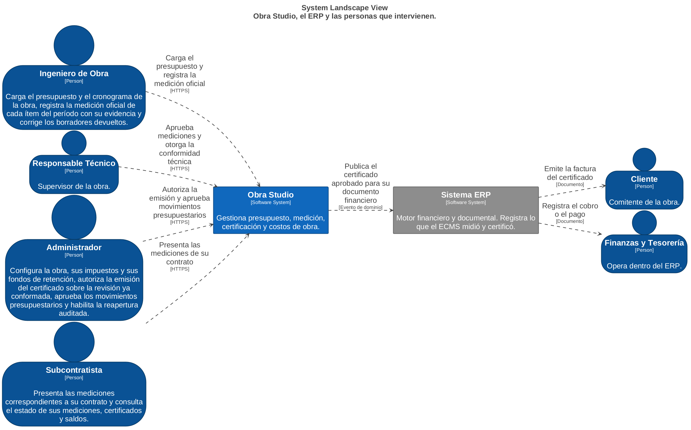
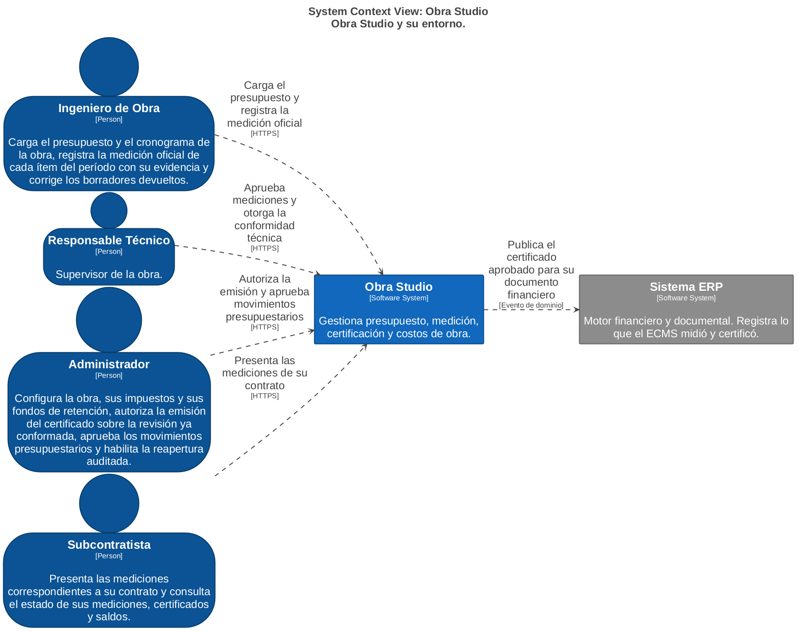
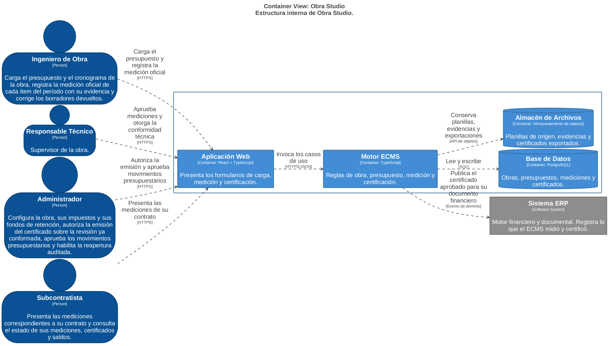
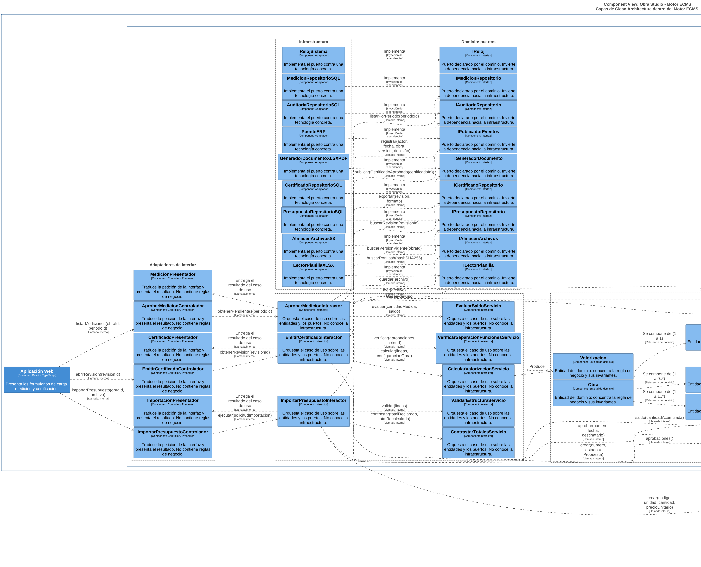
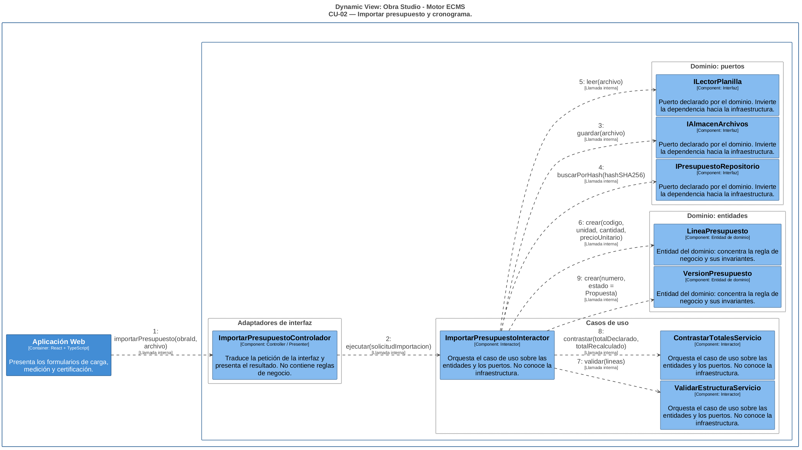
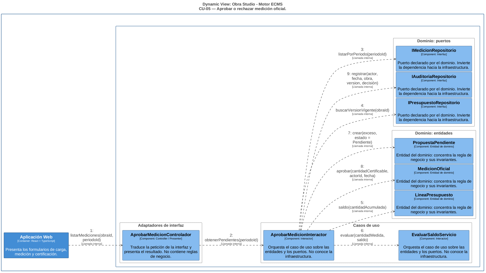
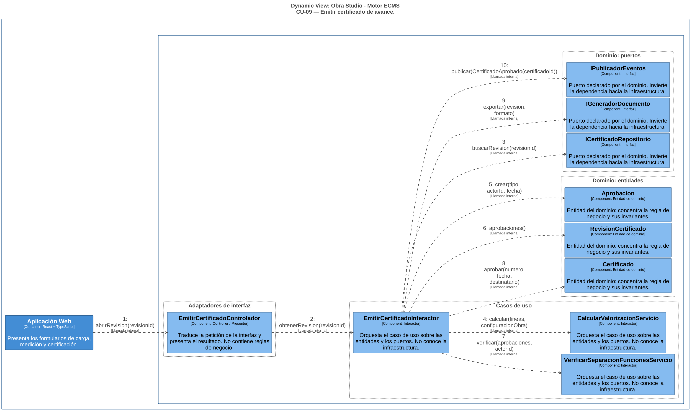

# Modelo de Análisis — Obra Studio

*Ingeniería del Software 2 · Trabajo Práctico Final · Dr. Emilio Gutiérrez Rodríguez*  
*Autores: Rojas, Sebastián · Taveira · Scotover*

Este archivo acompaña a [requerimientos-consolidados.md](requerimientos-consolidados.md) y al entregable `TPF-Obra-Studio.docx`. Reúne lo que no entra en la plantilla de la cátedra: el catálogo de casos de uso, las máquinas de estado, las decisiones de modelado, las vistas de arquitectura y la trazabilidad con la implementación.

Todo su contenido y todos los diagramas se generan desde `modelo/modelo.yaml`, que es la única fuente de verdad. Para reproducirlos, ejecutar `modelo/build.sh`.

## 1. Alcance

| Módulo | Nombre | Situación |
|---|---|---|
| `ecms.budgets` | Presupuestos | Desarrollado |
| `ecms.acu` | Análisis de Costo Unitario | Desarrollado |
| `ecms.certifications` | Certificaciones | Desarrollado |
| `ecms.subcontracts` | Subcontratos | Desarrollado |
| `erp.invoices` | Facturas | Desarrollado |
| `erp.payments` | Pagos | Desarrollado |
| `ecms.stock` | — | Excluido: PR-07 excluye la operación de inventario y almacén. |
| `ecms.rrhh` | — | Excluido: Fuera del alcance de presupuesto, medición y certificación. |
| `ecms.partes` | — | Excluido: La vía C del motor de costos se documenta sin desarrollar partes diarios. |
| `erp.petty-cash` | — | Excluido: Compras menores no intervienen en la cadena de certificación. |
| `erp.finance` | — | Excluido: Contabilidad y tesorería se tratan como contexto de interacción ERP. |

## 2. Vocabulario

La columna «Clase» nombra la clase del modelo; «Implementación» indica su contraparte en el código, cuando existe.

| Término | Inglés | Clase | Implementación |
|---|---|---|---|
| Obra | work site | `Obra` | projects (fila) |
| Presupuesto | budget | `Presupuesto` | ProjectFile / budgets |
| Versión de presupuesto | budget version | `VersionPresupuesto` | budgets.revision + budget_operations |
| Rubro | chapter | `LineaPresupuesto` | CostItem.rowType='chapter' |
| Ítem | budget line | `LineaPresupuesto` | CostItem.rowType='begrotingspost' |
| ACU | unit cost analysis | `AnalisisCostoUnitario` | CostItem.acu + calculateAcu() |
| Medición oficial | official measurement | `MedicionOficial` | no implementado (especificado) |
| Período | period | `Periodo` | no implementado (especificado) |
| Certificado de avance | advance certificate | `Certificado` | no implementado (especificado) |
| Valorización | valuation | `Valorizacion` | extiende el wiki: importe calculado del certificado |
| Movimiento presupuestario | budget movement | `MovimientoPresupuestario` | budgets kind='adendas', capítulo AD-N |
| Subcontrato | subcontract | `Subcontrato` | no implementado (especificado) |
| Socio | partner | `Socio` | no implementado (especificado) |
| Curva S | S-curve | `—` | extiende el wiki: reporte derivado, sin tabla propia |
| Fondo de reparo | retention fund | `RetencionAplicada` | no implementado (especificado) |

## 3. Catálogo de casos de uso

| ID | Caso de uso | Subsistema | Actores | Requisitos |
|---|---|---|---|---|
| CU-01 | Crear obra y asignar responsables | Presupuesto y Medición | Administrador | RF-01 |
| CU-02 | Importar presupuesto y cronograma **(detallado)** | Presupuesto y Medición | Ingeniero de Obra | RF-02, RF-03, RF-04, RF-06 |
| CU-03 | Confirmar estructura y activar versión vigente | Presupuesto y Medición | Administrador | RF-05 |
| CU-04 | Registrar medición oficial | Presupuesto y Medición | Ingeniero de Obra | RF-07, RF-10 |
| CU-05 | Aprobar o rechazar medición oficial **(detallado)** | Presupuesto y Medición | Responsable Técnico | RF-08, RF-09 |
| CU-06 | Cerrar período de medición | Presupuesto y Medición | Responsable Técnico | RF-11 |
| CU-07 | Generar borrador de certificado | Certificación y Subcontratos | Ingeniero de Obra | RF-09, RF-12, RF-13, RF-14, RF-15 |
| CU-08 | Devolver borrador para corrección | Certificación y Subcontratos | Responsable Técnico | RF-16 |
| CU-09 | Emitir certificado de avance **(detallado)** | Certificación y Subcontratos | Responsable Técnico, Administrador, Cliente | RF-17, RF-18, RF-22 |
| CU-10 | Derivar documento financiero en ERP | Certificación y Subcontratos | Motor de Ingeniería, Sistema ERP, Finanzas y Tesorería | RF-14, RF-18 |
| CU-11 | Proponer y aprobar movimiento presupuestario | Presupuesto y Medición | Administrador, Responsable Técnico | RF-06, RF-09, RF-19, RF-20, RF-21, RF-22 |
| CU-12 | Registrar contrato de subcontrato | Certificación y Subcontratos | Administrador | RF-23 |
| CU-13 | Presentar medición de subcontrato | Certificación y Subcontratos | Subcontratista | RF-24 |
| CU-14 | Certificar y valorizar subcontrato | Certificación y Subcontratos | Responsable Técnico, Subcontratista, Sistema ERP | RF-10, RF-25 |
| CU-15 | Calcular costos por vía | Presupuesto y Medición | Ingeniero de Obra, Motor de Ingeniería | RF-26 |
| CU-16 | Consultar reportes y Curva S | Certificación y Subcontratos | Administrador, Responsable Técnico | RF-27, RF-28 |

Relaciones entre casos de uso:

- `CU-02` **«include»** `CU-03`
- `CU-09` **«include»** `CU-07`
- `CU-09` **«include»** `CU-10`
- `CU-14` **«include»** `CU-10`
- `CU-08` **«extend»** `CU-09`
- `CU-11` **«extend»** `CU-05`

## 4. Máquinas de estado

### VersionPresupuesto


| Estado | Significado |
|---|---|
| Propuesta | Importada y confirmada en su estructura; todavía no rige. |
| Vigente | Rige para medición, certificación y control de saldo. |
| Reemplazada | Un movimiento aprobado generó una versión posterior; permanece consultable. |
| Descartada | La importación no se confirmó; no llegó a regir. |

| Desde | Evento | Guarda | Hacia |
|---|---|---|---|
| Propuesta | activar | estructura confirmada | Vigente |
| Propuesta | descartar | — | Descartada |
| Vigente | activar versión posterior | — | Reemplazada |

### MedicionOficial


| Estado | Significado |
|---|---|
| Registrada | Cargada por el Ingeniero de Obra con su evidencia; espera decisión. |
| Aprobada | El Responsable Técnico la validó; su cantidad cubierta es certificable. |
| Rechazada | Devuelta con motivo; no integra el acumulado físico. |

| Desde | Evento | Guarda | Hacia |
|---|---|---|---|
| Registrada | aprobar | actor distinto del que registró | Aprobada |
| Registrada | rechazar | motivo informado | Rechazada |
| Rechazada | corregir y reenviar | — | Registrada |

### Certificado


| Estado | Significado |
|---|---|
| Borrador | Generado desde mediciones aprobadas elegibles; editable. |
| Emitido | Presentado para conformidad técnica y autorización. |
| Aprobado | Conformado y autorizado por actores distintos; origina el documento financiero ERP. |
| Cerrado | Período liquidado; el certificado y sus fuentes permanecen consultables. |

| Desde | Evento | Guarda | Hacia |
|---|---|---|---|
| Borrador | emitir revisión | — | Emitido |
| Emitido | devolver para corrección | observación registrada | Borrador |
| Emitido | autorizar | conformidad técnica de un actor distinto | Aprobado |
| Aprobado | cerrar período | — | Cerrado |
| Cerrado | reapertura autorizada | auditada; crea revisión vinculada | Borrador |

### MovimientoPresupuestario


| Estado | Significado |
|---|---|
| Propuesto | Registrado con tipo, objetivo, motivo y respaldo documental. |
| AprobadoInterno | La organización lo aprobó; todavía no modifica el presupuesto. |
| AprobadoContractual | El comitente lo aceptó; habilita la nueva versión. |
| Vigente | Generó una versión de presupuesto nueva que ya rige. |
| Rechazado | No prosperó; el presupuesto vigente no cambia. |

| Desde | Evento | Guarda | Hacia |
|---|---|---|---|
| Propuesto | aprobar internamente | datos completos y dentro del límite | AprobadoInterno |
| Propuesto | rechazar | — | Rechazado |
| AprobadoInterno | aprobar contractualmente | — | AprobadoContractual |
| AprobadoInterno | rechazar | — | Rechazado |
| AprobadoContractual | activar versión | — | Vigente |

## 5. Decisiones de modelado

Cada fila es una discrepancia hallada entre el catálogo de requerimientos y la documentación de dominio, con la resolución adoptada.

### D-01 — Términos ausentes en la documentación de dominio

**Hallazgo.** «Valorización» y «Curva S» no aparecen en ninguna versión de la documentación de Obra Studio.

**Resolución.** Se conservan como requisitos (RF-13, RF-25 y RF-27) y se declaran en la tabla de vocabulario como alcance que extiende el dominio documentado. Valorización designa el importe calculado del certificado; Curva S es un reporte derivado que no agrega tabla propia.

### D-02 — Aditivos y deductivos

**Hallazgo.** El catálogo habla de aditivos y deductivos; la documentación de dominio no usa esos términos.

**Resolución.** Se unifican en MovimientoPresupuestario con tipo AMPLIACION, DEDUCCION o VARIACION_PRECIO, que es el vocabulario del dominio.

### D-03 — Rol de responsable técnico

**Hallazgo.** El catálogo nombra un «responsable técnico» que no existe como rol en el dominio.

**Resolución.** Se asimila al Supervisor y se reparte la responsabilidad en tres actores: el Ingeniero de Obra registra, el Responsable Técnico aprueba y el Administrador autoriza la emisión.

### D-04 — Idempotencia de la importación

**Hallazgo.** RNF-07 exige que recargar el mismo XLSX no cree otra versión, pero la implementación actual calcula el hash sobre el documento ya confirmado y no sobre el archivo.

**Resolución.** ArchivoOrigen declara hashSHA256 sobre el contenido del archivo y la importación lo consulta antes de crear una versión, de modo que el requisito se cumple tal como está enunciado.

### D-05 — Doble conteo de trabajo físico

**Hallazgo.** RF-10 exige impedir que una misma cantidad se contabilice dos veces, sin indicar el mecanismo.

**Resolución.** Existe una sola MedicionOficial por ítem y período, con el ejecutor como atributo en lugar de un registro separado para el subcontratista. El acumulado se incrementa una sola vez por construcción del modelo, no por una validación añadida.

### D-06 — Estados del movimiento presupuestario

**Hallazgo.** RF-21 exige aprobación interna y contractual separadas; el dominio no define estados para el movimiento.

**Resolución.** Se diseña el ciclo Propuesto, AprobadoInterno, AprobadoContractual y Vigente, más Rechazado. Solo la transición a Vigente genera una versión de presupuesto nueva.

### D-07 — Estados del certificado

**Hallazgo.** La documentación describe el certificado con tres, cuatro y cinco estados según el documento, y trata el rechazo unas veces como estado y otras como transición.

**Resolución.** Se unifica en Borrador, Emitido, Aprobado y Cerrado. El rechazo es la transición de Emitido a Borrador. La reapertura de un certificado cerrado es autorizada y auditada, crea una revisión vinculada y preserva el original.

### D-08 — Modelo de permisos

**Hallazgo.** Una parte de la documentación define una matriz de roles y otra afirma que la aplicación no debe definir ningún rol.

**Resolución.** Se adopta la matriz de roles, porque RNF-01 exige comprobar el rol y RF-17 exige separación de funciones entre quien conforma y quien autoriza.

### D-09 — Propiedad del contrato de subcontrato

**Hallazgo.** Un documento asigna el contrato al ERP y otro al ECMS.

**Resolución.** Se aplica la regla de propiedad por naturaleza del registro: el hecho de campo pertenece al ECMS y el documento legal al ERP. El contrato es del ERP; el certificado, del ECMS.

### D-10 — Persistencia del árbol de presupuesto

**Hallazgo.** La implementación guarda el presupuesto como documento JSON y no como tablas normalizadas.

**Resolución.** El diagrama de entidad relación presenta el modelo normalizado, que es lo que corresponde al modelo de diseño. El almacenamiento documental se documenta como decisión de implementación y no altera el modelo conceptual.

### D-11 — Atributos derivados

**Hallazgo.** Importes como el acumulado certificado o el saldo podrían almacenarse y quedar desfasados.

**Resolución.** Se marcan como derivados en el diagrama de clases y se omiten como columnas en el diagrama de entidad relación: se calculan desde los registros aprobados y no pueden discrepar de su origen.

### D-12 — Alcance del trabajo

**Hallazgo.** Obra Studio no tiene ningún módulo de taller ni de fabricación, ni en la documentación ni en el catálogo de módulos de la implementación.

**Resolución.** No hay nada que excluir por ese concepto. El alcance se acota explícitamente a seis módulos y se declaran los excluidos con su motivo.

## 6. Arquitectura

El Motor ECMS aplica Clean Architecture en cuatro anillos; las dependencias apuntan siempre hacia adentro. Los estereotipos de análisis son su proyección en UML:

| Estereotipo UML | Anillo | Responsabilidad |
|---|---|---|
| `«Boundary»` | Adaptadores de interfaz | Traduce la petición y presenta el resultado. |
| `«Control»` | Casos de uso | Orquesta entidades y puertos. |
| `«Entity»` | Dominio | Concentra la regla de negocio y sus invariantes. |
| `«Interface»` | Dominio (puertos) | Invierte la dependencia hacia la infraestructura. |

Puertos declarados por el dominio:

| Puerto | Operaciones | Adaptador |
|---|---|---|
| `IPresupuestoRepositorio` | `buscarVersionVigente(obraId)`, `buscarPorHash(hash)`, `guardarVersion(version)` | `PresupuestoRepositorioSQL` |
| `IAlmacenArchivos` | `guardar(archivo)`, `recuperar(ruta)` | `AlmacenArchivosS3` |
| `ILectorPlanilla` | `leer(archivo)`, `detectarEstructura(hojas)` | `LectorPlanillaXLSX` |
| `IMedicionRepositorio` | `listarPorPeriodo(periodoId)`, `guardar(medicion)`, `acumuladoAprobado(lineaId)` | `MedicionRepositorioSQL` |
| `ICertificadoRepositorio` | `buscarRevision(revisionId)`, `guardar(certificado)`, `siguienteNumero(obraId)` | `CertificadoRepositorioSQL` |
| `IGeneradorDocumento` | `exportar(revision, formato)` | `GeneradorDocumentoXLSXPDF` |
| `IPublicadorEventos` | `publicar(evento)` | `PuenteERP` |
| `IAuditoriaRepositorio` | `registrar(entrada)` | `AuditoriaRepositorioSQL` |
| `IReloj` | `ahora()` | `RelojSistema` |

Vistas C4 generadas con Structurizr (`modelo/workspace.dsl`, salida en `modelo/out/c4/`):


**Paisaje.** Obra Studio, el ERP y las personas que intervienen.



**Contexto.** Obra Studio y su entorno.



**Contenedores.** Estructura interna de Obra Studio.



**Componentes.** Los cuatro anillos de Clean Architecture dentro del Motor ECMS.



**CU02.** Interacción de componentes al importar el presupuesto.



**CU05.** Interacción de componentes al aprobar una medición.



**CU09.** Interacción de componentes al emitir un certificado.




Diagramas UML del entregable (`modelo/out/`):

| Archivo | Diagrama |
|---|---|
| `01-casos-de-uso-A.png` | casos de uso A |
| `02-casos-de-uso-B.png` | casos de uso B |
| `03-CU-02-clases.png` | CU 02 clases |
| `04-CU-05-clases.png` | CU 05 clases |
| `05-CU-09-clases.png` | CU 09 clases |
| `06-CU-02-secuencia.png` | CU 02 secuencia |
| `07-CU-05-secuencia.png` | CU 05 secuencia |
| `08-CU-09-secuencia.png` | CU 09 secuencia |
| `09-clases-persistentes-A.png` | clases persistentes A |
| `10-clases-persistentes-B.png` | clases persistentes B |
| `11-entidad-relacion.png` | entidad relacion |
| `12-estado-VersionPresupuesto.png` | estado VersionPresupuesto |
| `13-estado-MedicionOficial.png` | estado MedicionOficial |
| `14-estado-Certificado.png` | estado Certificado |
| `15-estado-MovimientoPresupuestario.png` | estado MovimientoPresupuestario |

## 7. Trazabilidad con la implementación

El motor de presupuesto está implementado; certificaciones y subcontratos están especificados en la documentación de dominio pero no implementados. Los diagramas de este trabajo son modelo de diseño, no transcripción del código.

| Clase del modelo | Situación | Contraparte |
|---|---|---|
| `Obra` | Implementado | Fila de la tabla projects. |
| `Presupuesto` | Implementado | Tabla budgets, con tipo cliente, costo o adendas. |
| `VersionPresupuesto` | Implementado | Columna revision más el diario inmutable budget_operations. |
| `LineaPresupuesto` | Implementado | CostItem dentro del documento del presupuesto. |
| `AnalisisCostoUnitario` | Implementado | Partida marcada como ACU y su cálculo. |
| `ArchivoOrigen` | Implementado | Importación con hash del contenido. |
| `InformeImportacion` | Implementado | Informe de importación con totales declarado y recalculado. |
| `MedicionOficial` | Especificado | Documentada en el dominio; sin implementación. |
| `Periodo` | Especificado | Documentada en el dominio; sin implementación. |
| `Certificado` | Especificado | Módulo de certificaciones presente en el catálogo, sin implementación. |
| `Subcontrato` | Especificado | Módulo de subcontratos presente en el catálogo, sin implementación. |
| `DocumentoFinancieroERP` | Especificado | Factura y pago del ERP; fuera del alcance implementado. |

## 8. Reproducibilidad

```
modelo/
  modelo.yaml      fuente única: actores, requisitos, casos de uso, entidades, estados, tablas
  gen/validar.py   chequeos de consistencia; el build falla si algo no cierra
  gen/gen_puml.py  genera los diagramas UML
  gen/gen_dsl.py   genera el workspace de Structurizr
  gen/gen_docx.py  genera el documento con el formato de la cátedra
  gen/gen_md.py    genera este archivo
  build.sh         ejecuta todo lo anterior de punta a punta
```

`validar.py` comprueba, entre otras cosas, que los 48 identificadores del catálogo estén presentes sin duplicados, que cada requisito mapee a un caso de uso existente, que ningún caso de uso quede sin requisito, que toda clase citada en un diagrama exista en el modelo, que cada mensaje dirigido a un puerto sea uno de sus métodos declarados y que ningún estado sea inalcanzable.

